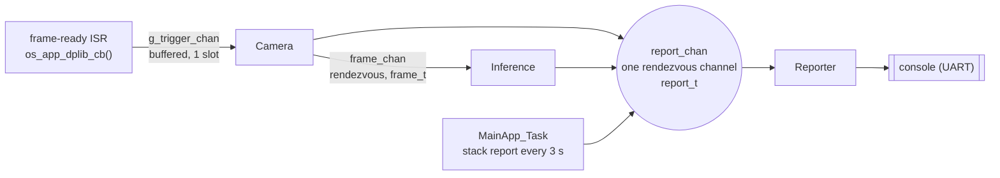

# CSP Neuropathway Image Uplink on Himax WE2

This app extends the person-detection pipeline of [`csp4cmsis_allon_sensor_tflm`](../csp4cmsis_allon_sensor_tflm) (Camera → Inference → Reporter, built from **Communicating Sequential Processes (CSP)** on the Himax WE2, Grove Vision AI V2, with an IMX219 camera). Its goal is to send the best JPEG out of every window of 20 frames to the PC over the existing console UART (921 600 Bd over USB-C), without the camera ever waiting for the link. It uses CSP4CMSIS 3.0.1 on FreeRTOS 10.5.1, through the SDK's CMSIS-RTOS2 adapter (`OS_HAL := y`; the kernel is started with `osKernelInitialize()`/`osKernelStart()`), and the Ethos-U55 NPU.

The work follows a staged plan; each stage must pass on the board before the next starts:
* **Stage 0, retargeting test (gate):** point the JPEG DMA (WDMA2) at a different buffer before each capture and check that the hardware follows (section 7).
* **Stage 1, link:** binary frames from the Reporter, and a PC receiver that saves the JPEGs and prints the text lines.
* **Stage 2, ownership token:** Inference hands the next DMA buffer back to Camera after rescaling, so the camera re-arms while `Invoke()` runs.
* **Stage 3, best-of-20:** four JPEG buffers in fixed roles (DMA target, being scored, best of the window, being sent); the uplink returns its buffer when the send is done, and a window whose best cannot be sent yet is merged into the next.
* **Stage 4, formal model:** the CSP-M model extended with buffer ids as data.

**Status (2026-10-27):** Stage 0 is built but has not yet run on the board. Without `-DUPLINK_STAGE0` the app behaves like `csp4cmsis_allon_sensor_tflm`; sections 1-6 describe that default build and note what the Stage 0 build changes.

The explanations for this code are in the book; the source files deliberately contain no comments.


## 🏗 Architecture Overview

The system is designed as a **Static Network** of independent processes communicating over synchronous channels. The frame data itself is never copied: it stays in the sensor's buffer, and the channels carry small descriptors -- `frame_t` (frame index, JPEG address and size) and `report_t` -- each copied once, from the writer to the reader.



### 1. Camera Handshake (ISR to Process)
To ensure no frames are dropped or partially read, the system uses a private trigger channel:
* **The ISR:** the sensor data path calls `os_app_dplib_cb` from its frame-end interrupt (`SC_sen_nframe_end_IRQn`, measured on the board). On `SENSORDPLIB_STATUS_XDMA_FRAME_READY` it writes a trigger to a one-slot `BufferedChannel<trigger_t, 1>` through `isrWriter().putFromISR()`.
* **Why not a rendezvous channel:** a rendezvous completes only when writer and reader meet, so the writer must be able to wait for its partner. An interrupt cannot wait, so CSP4CMSIS gives rendezvous channels no ISR writer at all. Before 2.0 the ISR used `putFromISR()` on a rendezvous anyway; when the Camera process was not already waiting, the trigger was simply dropped -- and since Camera re-arms the capture only after a trigger, the camera then stopped for good. The one-slot buffer keeps the trigger until Camera reads it.
* **One slot is enough:** Camera re-arms the capture only after it has read the trigger, so at most one frame-ready can be pending. If a write ever fails, a second frame-ready arrived before the first was read (a driver bug): the callback prints `FATAL: camera frame-ready trigger lost ...` and halts instead of losing the frame silently.
* **Interrupt priority:** an interrupt whose handler calls CSP4CMSIS or FreeRTOS must run at priority 5..7 (`CSP4CMSIS_MAX_SYSCALL_INTERRUPT_PRIORITY` = 5, 3 priority bits); the SDK leaves every interrupt at 0. `Camera::run()` sets `SC_sen_nframe_end_IRQn` to 5 before the data path starts. The NPU interrupt (`U55_IRQn`) gives an RTOS semaphore (point 3), so `cvapp.cpp` sets it to 5 too, before enabling it. The data path's other interrupts (84, 143, 154-157) make no RTOS or CSP4CMSIS calls and stay as they are.
* **The Process:** the Camera process blocks on this trigger, ensuring a lossless, synchronized handshake between hardware and software.
* **Under `-DUPLINK_STAGE0`:** the handshake is the same, but it ends by design after 100 frames. Camera no longer re-arms the capture, so no further frame-ready interrupt comes and Camera blocks on the trigger channel for good (section 2).

### 2. Frame Re-triggering
To prevent buffer overruns and keep the pipeline in lockstep, the Camera process explicitly calls `sensordplib_retrigger_capture()` only **after** the current frame has been successfully passed to the inference stage. This creates natural back-pressure.

**Under `-DUPLINK_STAGE0`**, Camera does two more things between passing the frame on and re-arming: it zeroes the first 32 bytes of the other JPEG buffer and points WDMA2 at it (`cisdp_set_jpeg_buf()`), so the buffers alternate from frame to frame. After frame 99 it does not re-arm at all: it reports the verdict, has both buffers dumped and waits for ever, and Inference waits for a frame that never comes (section 7).

### 3. Model Inference
The inference process utilizes the `cvapp` module from the Himax SDK:
* **NPU:** Initialises the Ethos‑U55.
* **Inference blocks during `Invoke()`:** the Ethos-U driver waits for the NPU with a semaphore. Its own bare-metal version spins in `__WFE()` (and `malloc()`s each semaphore); `ethosu_rtos_semaphore.c` replaces it with CMSIS-RTOS2 semaphores whose control blocks are static. While the NPU runs, Inference is blocked and the CPU is free; the NPU's end-of-job interrupt, at priority 5 like the frame-ready interrupt, releases the semaphore and Inference continues. Measured over 60 s (1164 frames): one take per frame; `Invoke()` takes 1.61 ms (642 k cycles at 400 MHz), of which about 1.1 ms was spent spinning before; the CPU's idle share rose from 95.3 % to 97.4 %. The frame rate is unchanged: the camera sets it, not the NPU.
* **Model:** Loads a specialized person‑detection TFLM model.
* **Data Path:** Runs inference on raw YUV frames (accessed via `app_get_raw_addr()`).
* **Start-up order:** Inference initialises the model only when its first frame has arrived, i.e. after Camera has started.

### 4. Reporter: the console has one owner
The console is a shared resource, and `xprintf()` has no locking, so two processes printing at the same time tear each other's lines. The **Reporter** is therefore the only process that prints while the network runs. Camera, Inference and `MainApp_Task` send it fixed-size `report_t` messages (`common_types.h`: kind, code, the reporting thread's name -- a string literal, so only the pointer is copied -- frame index, values) over **one rendezvous channel with three writers**; the Reporter owns every format string and prints exactly one line per report: one per frame, plus MainApp's stack report every 3 s. The Reporter has no state and no timer: it only receives and prints.
* **Rendezvous, not buffered:** nothing is lost, and the cost is small: at 921 600 Bd a result line takes about 0.5 ms, against 51.6 ms per frame (19.4 frames/s, measured over 60 s). Camera reports only at start-up, so its frame loop never waits for the console. A `KeepNewest` buffer would drop reports silently. Under `-DUPLINK_STAGE0` Camera also sends one check report per frame, before it passes the frame on, so the Stage 0 build does wait for the console.
* **Before the Reporter's first line**, only the camera driver prints (its start-up log, during `cisdp_sensor_init()`/`cisdp_dp_init()`): Inference is still waiting for the first frame, and MainApp, which never prints, sends its first stack report only 3.5 s after start (on the board, Camera reported `started` about 2.9 s before it). The frame-ready ISR's `FATAL` message is the one exception: it halts the system.

### 5. Memory & Performance
* **Zero Heap:** All CSP channels and processes, every thread's stack, and the Ethos-U driver's semaphores are statically allocated at compile time; the FreeRTOS heap is not used (`configTOTAL_HEAP_SIZE` 1 KB, 0 allocations measured). The C library heap (16 KB, `__HEAP_SIZE` in the linker script) sees two allocations, both at start-up and never freed: 1088 bytes for the C++ runtime's emergency exception buffer (libstdc++, before `main()`) and 12 bytes for the Ethos-U driver's device structure (`ethosu_dev_init()`, when Inference initialises the model); 1112 bytes in use including `malloc()`'s bookkeeping (`mallinfo()`), and no allocation while frames run.
* **Frame buffers:** all in `.bss.NoInit`, set up in `cis_sensor/cis_imx219/cisdp_sensor.c`: `demosbuf` (raw YUV420 at 640x480, 460 800 bytes, read by Inference), `jpegfilesizebuf` (100 bytes; the encoder writes the JPEG size here) and the `jpegbuf` array of `CISDP_JPEG_BUF_CNT` JPEG buffers. Each JPEG buffer is `JPEG_BUFSIZE` (46 256 bytes at 640x480) rounded up to a multiple of 32, i.e. 46 272 bytes, so that cache maintenance on one buffer never touches its neighbour. `CISDP_JPEG_BUF_CNT` is 2 (92 544 bytes); the default build uses only buffer 0, the Stage 0 build alternates both. Stage 3 needs 4, another 92 544 bytes.
* **SRAM:** 987 KB of 1924 KB used (51.3 %, from the linker), with 2 JPEG buffers: about 45 KB more than with the single `jpegbuf`. The largest items are `demosbuf`, the model (251 568 bytes) and the tensor arena (128 000 bytes).
* **Concurrency:** Each process runs in its own thread (`osPriorityLow2`), created by `Run(..., ExecutionMode::StaticNetwork)` from `MainApp_Task` (`osPriorityLow3`).
* **Console output:** one line per frame, printed by the Reporter only (before, each result was printed twice, by Inference and by a Console process, and lines from different processes interleaved mid-string).

### 6. Formal Model
[`Formal model/`](Formal%20model/) holds a CSP-M model of this network (Camera → Inference → Reporter, one report channel with three writers: Camera, Inference and MainApp), checked with ProB 1.16.1: deadlock and divergence freedom; refinement against a specification of the console's pipeline lines (the camera driver's log, the two `started` lines, then exactly one result line per frame, in frame order) and of its stack lines (complete groups, for ever); and, with Inference stalled, no deadlock and an unchanged stack report. Three positive controls fail as they should: a Reporter that reads per-writer channels in a fixed order (deadlock), an Inference that also prints (specification violated), and the previous design with the stack report in the Reporter (the stack report stops when the pipeline stalls).

The model covers the default build only. The Stage 0 build (Camera's per-frame reports, the stop after 100 frames, the buffer dump) and the JPEG buffers are not modelled; Stage 4 adds the buffer ids as data.

### 7. Image Uplink, Stage 0: retargeting the JPEG buffer (gate test)
The uplink design keeps several JPEG buffers and points WDMA2 at a different one before each capture. Stage 0 checks that the hardware follows before anything is built on it.
* **The library setter is not enough.** `sensordplib_set_xDMA_baseaddrbyapp()` only stores the three addresses in the library's own variables (`g_dp_wdma1/2/3_addr`). The WDMA2 address reaches the hardware (the WDMA2 start-address register, xDMA offset `0x44`) only when the data path is set up, through `hx_drv_xdma_set_WDMA2allCfg()` inside `cisdp_dp_init()`. `sensordplib_retrigger_capture()` never reads the stored addresses: the disassembly of `libsensordp.a` shows that it only re-enables the stream, clears the INP software reset, re-arms the xDMA watchdog and sets the sensor control's clock and reset. `cisdp_set_jpeg_buf(id)` therefore writes the register itself with `hx_drv_xdma_set_WDMA2Addr()`. It also updates `g_wdma2_baseaddr`, which `cisdp_get_jpginfo()` reads, and the library's copy, so a later data-path setup uses the same buffer.
* **Why the reported address alone proves nothing:** with `cyclic_buffer_cnt = 1`, `cisdp_get_jpginfo()` computes the JPEG address from `g_wdma2_baseaddr` (slot 0), i.e. from the software variable, whatever the DMA did. The test therefore checks four things for every frame, one bit each in `flags`:
  * 1: `jpeg_addr` from `cisdp_get_jpginfo()` is the target buffer;
  * 2: the WDMA2 register reads back the target buffer (`cisdp_get_wdma2_hw_addr()`);
  * 4: the target buffer starts with a JPEG SOI (`FF D8`). Camera zeroed its first 32 bytes before the capture, so only the DMA can have put it there;
  * 8: a JPEG EOI (`FF D9`) lies at the end of the reported size, followed by at most 3 bytes of padding (the encoder may pad the size).

  `flags f` (all four) is a pass.
* **Run:** build with `-DUPLINK_STAGE0` (set in the `.mk`). Camera alternates buffers 0 and 1 for 100 frames and prints one line per frame, `Camera: frame ... buf ... jpeg_addr ... wdma2 ... size ... flags ... ok|FAIL`, then `Camera: STAGE0 PASS|FAIL (n of 100 frames ok)`. It then stops the capture, so that neither buffer changes while it is printed, and the Reporter dumps both buffers as hex (`JPEG BEGIN` ... `JPEG END`). On the PC, `python3 tools/stage0_capture.py --port /dev/ttyACM0 --out stage0` checks the lines and writes `stage0_buf0_frame98.jpg` and `stage0_buf1_frame99.jpg`, decoding them if Pillow is installed (`--log <file>` reads a saved console log instead).
* **Pass:** the board prints `PASS (100 of 100 frames ok)`, both images decode, and they differ. If bit 2 fails, WDMA2 does not take the new address, and the design changes. If only bit 8 fails, look at the decoded images before calling it a failure: the padding may be longer than the check allows.

---

## 🔧 Key Code Snippets

Excerpts; see the source files for the complete code.

### Camera Process (`camera_process.cpp`)
```cpp
static BufferedChannel<trigger_t, 1> g_trigger_chan;

extern "C" void os_app_dplib_cb(SENSORDPLIB_STATUS_E event) {
  if (event == SENSORDPLIB_STATUS_XDMA_FRAME_READY) {
    if (!g_trigger_chan.isrWriter().putFromISR(trigger_t {})) {
      __disable_irq();
      xprintf("\r\nFATAL: camera frame-ready trigger lost (the previous one was not read yet)\r\n");
      for (;;) { }
    }
  }
}

void Camera::run() {
  trigger_t t;
  auto trigger_reader = g_trigger_chan.reader();
  report_t r = {};
  r.name = name();
  // ... sensor and data-path initialisation; on failure: report Failed and return ...
  cisdp_sensor_start();
  r.kind = ReportKind::Started;
  m_report_out.write(r);

  while (true) {
    trigger_reader.read(t);

    uint32_t jpeg_addr, jpeg_sz;
    cisdp_get_jpginfo(&jpeg_sz, &jpeg_addr);

    frame_t f;
    f.index = m_frame_counter++;
    f.jpeg_addr = jpeg_addr;
    f.jpeg_sz = jpeg_sz;

    m_frame_out.write(f);
    sensordplib_retrigger_capture();
  }
}
```
Under `-DUPLINK_STAGE0` the loop has three additions: before `m_frame_out.write(f)`, Camera checks the buffer (`check_jpeg_buf()`) and sends a `ReportKind::BufferCheck` report; after it, at frame 100, it sends `ReportKind::BufferVerdict` and two `ReportKind::JpegDump` reports and then blocks on the trigger channel for good; otherwise it calls `arm_jpeg_buf()` on the other buffer (zero its first 32 bytes, clean them from the D-cache, `cisdp_set_jpeg_buf()`) before `sensordplib_retrigger_capture()`. Before `cisdp_sensor_start()` it arms buffer 0.

### Inference Process (`inference_process.cpp`)
```cpp
void Inference::run()
{
    frame_t f;
    m_frame_in.read(f);

    report_t r = {};
    r.name = name();
    int err = cv_init(true, true);
    // ... on failure: report Failed (code = err) and return; otherwise report Started ...

    while (true) {
        int8_t person_score = 0, no_person_score = 0;
        int status = cv_run(&person_score, &no_person_score);

        r = {};
        r.kind = ReportKind::Result;
        r.name = name();
        r.code = (int16_t)status;
        r.index = f.index;
        r.value[0] = person_score;
        r.value[1] = no_person_score;
        m_report_out.write(r);

        m_frame_in.read(f);
    }
}
```

### Network Construction (`csp4cmsis_spn.cpp`)
```cpp
void MainApp_Task(void* params)
{
    (void)params;
    SleepFor(Milliseconds(500));

    static Channel<frame_t>  frame_chan;
    static Channel<report_t> report_chan;

    static Camera    camera(frame_chan.writer(), report_chan.writer());
    static Inference inference(frame_chan.reader(), report_chan.writer());
    static Reporter  reporter(report_chan.reader());

    auto network = InParallel(camera, inference, reporter);
    Run(network, ExecutionMode::StaticNetwork, NETWORK_PRIORITY);

    Chanout<report_t> report_out = report_chan.writer();
    while (true) {
        SleepFor(Milliseconds(CSP_STACK_REPORT_INTERVAL_MS));
        network.forEachProcess([&](CSProcess& p) {
            report_out << stackReport(p.name(), p.stackWords() * sizeof(uint32_t),
                                      p.stackHighWaterMarkWords());
        });
        report_out << stackReport("CSP_Main", sizeof(mainAppStack),
                                  osThreadGetStackSpace(osThreadGetId()) / sizeof(uint32_t));
    }
}
```

## 📊 Stack Occupancy Reporting

`MainApp_Task` sends the stack report: every `CSP_STACK_REPORT_INTERVAL_MS` (default 3000 ms, overridable at compile time) it sends one `ReportKind::Stack` report per process (`network.forEachProcess(...)`: Camera, Inference, Reporter) and one for itself (`osThreadGetStackSpace()` of its own thread, `CSP_Main`), each with used and allocated bytes and the HWM in words, over its own writer end of the report channel; the Reporter prints each as one line. The report runs on MainApp's own timer, so it continues when the pipeline stalls (tested on the board: with Inference stopped after frame 100, the report went on every 3 s). MainApp is an ordinary CMSIS-RTOS2 thread: a rendezvous may be used by any thread (it blocks on thread flag 0 of the calling thread, which MainApp uses for nothing else). It runs above the network (`osPriorityLow3`), so a busy network process does not hold the report up. If a process doesn't expose a HWM, this is reported as unavailable rather than guessed at.

Because camera/inference/reporter all run forever, there's no natural "network finished" point to take a single reading at -- these are *live, worst-observed-so-far* readings, and are only trustworthy once each process's deepest call path has actually been exercised (e.g. after error/edge-case branches in inference or the reporter have run at least once).

### Sample Output
```text
Frame 113: prediction = -13
Frame 114: prediction = -12
Camera: 768/1536 bytes used (768 bytes unused headroom, 192 words HWM)
Inference: 560/1024 bytes used (464 bytes unused headroom, 116 words HWM)
Reporter: 472/1024 bytes used (552 bytes unused headroom, 138 words HWM)
CSP_Main: 464/1024 bytes used (560 bytes unused headroom, 140 words HWM)
Frame 115: prediction = -12
```

| Task | Allocated | Used | Unused Headroom |
|---|---|---|---|
| Camera | 1536 bytes | 768 bytes | 768 bytes |
| Inference | 1024 bytes | 560 bytes | 464 bytes |
| Reporter | 1024 bytes | 472 bytes | 552 bytes |
| CSP_Main (MainApp) | 1024 bytes | 464 bytes | 560 bytes |

Camera uses 768 bytes (744 before it sent reports); before 2.0 it had only 1024 bytes (280 bytes of headroom), since CSP4CMSIS 2.0.1 it has 1536 bytes (384 words). Inference and the Reporter have comfortable margins. Inference uses 560 bytes since it blocks in the semaphore wait during `Invoke()` (488 bytes when it spun); the Reporter's figure grows during the first seconds and reached 448 or 472 bytes, depending on the run.

## 🚀 How to Run
### Prerequisites

* **Hardware:** Himax WE2‑based board (Grove Vision AI Module V2).
* **Sensor:** IMX219 Camera Module.
* **Toolchain:** ARM GNU Toolchain (13.2.Rel1 or later).
* **Build system:** Himax WE2 SDK.

### Build Instructions
1. Navigate to the application directory:
```
CSP4CMSIS/EPII_CM55M_APP_S
```
2. Set the application type in the `makefile`:
```
APP_TYPE=csp4cmsis_neuropathway_image_uplink
```
3. Build the project:
```
make clean 
make
```
4. Generate the image and flash it over the USB serial port with xmodem, as described in the top-level README.

### Expected UART Output
```text
cis_IMX219_init
...                      (the camera driver's start-up log)
IMX219 on by app done
g_cursensorstream: 0
Camera: started
Inference: started
Frame 0: prediction = -14
Frame 1: prediction = -12
...
Camera: 768/1536 bytes used (768 bytes unused headroom, 192 words HWM)
Inference: 560/1024 bytes used (464 bytes unused headroom, 116 words HWM)
Reporter: 472/1024 bytes used (552 bytes unused headroom, 138 words HWM)
CSP_Main: 464/1024 bytes used (560 bytes unused headroom, 140 words HWM)
...
```
This is the default build. The Stage 0 build prints a `Camera: frame ...` check line before each result line, and stops after frame 99 with the verdict and the two hex dumps (section 7).

Stack occupancy lines like the block above are printed every `CSP_STACK_REPORT_INTERVAL_MS` (3 s by default) once the network is running -- see [Stack Occupancy Reporting](#-stack-occupancy-reporting) below.

## 📁 File Structure
```text
app/scenario_app/csp4cmsis_neuropathway_image_uplink/
├── camera_process.h        // Camera process declaration
├── camera_process.cpp      // Camera implementation + ISR handling
├── inference_process.h     // Inference process declaration
├── inference_process.cpp   // Inference implementation (Ethos-U55)
├── cvapp.cpp               // Model, NPU initialisation (NPU interrupt at priority 5), cv_run()
├── ethosu_rtos_semaphore.c // Ethos-U driver semaphores: Inference blocks during Invoke()
├── reporter_process.h      // Reporter process declaration
├── reporter_process.cpp    // Reporter: the only process that prints (one line per report)
├── common_types.h          // Shared structs (frame_t, report_t)
├── csp4cmsis_spn.cpp       // Network construction & Main task
├── cis_sensor/cis_imx219/  // IMX219 driver: frame buffers, cisdp_set_jpeg_buf()
├── Formal model/           // CSP-M model of the network (default build), positive controls, ProB results
├── tools/stage0_capture.py // PC side of the Stage 0 test
└── csp4cmsis_neuropathway_image_uplink.mk  // App makefile (UPLINK_STAGE0, sensor selection)
```

## 🐛 Troubleshooting
* **`Camera: started` but no `Frame` lines:** check that `cisdp_sensor_start()` succeeds and that the sensor cable is seated.
* **`FATAL: camera frame-ready trigger lost`:** a second frame-ready arrived before Camera read the first, although Camera re-arms the capture only after reading. Check the data-path driver.
* **`IMX219 off by app fail` / `Camera: initialisation FAILED (step 1)`** (I2C error -60 at start-up): the camera module keeps its state across a WE2 reset; seen intermittently with both the pre-2.0 and the 2.0.1 build. Run the app again, or flash a non-camera app first.
* **The pipeline stops after the first frame:** Camera must call `sensordplib_retrigger_capture()` after passing each frame on (end of its loop); without it, no further frame-ready interrupt comes. The stack report still arrives every 3 s when the pipeline stops.
* **Buffer sizes:** the only buffered channel is the one-slot trigger channel, and one slot is enough because Camera re-arms the capture only after reading the trigger. A buffered channel you add must be sized for the frame rate (about 19.4 frames/s).
* **Stack overflow or corruption:** watch the stack report (see [Stack Occupancy Reporting](#-stack-occupancy-reporting)); if a process's unused headroom approaches 0, increase its `CSProcessStatic<N>` size.

## 📝 License
This example is provided under the standard Himax SDK license terms. Refer to the top‑level license file in the SDK for details.
