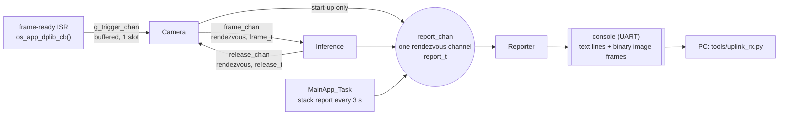

# CSP Neuropathway Image Uplink on Himax WE2

This app extends the person-detection pipeline of [`csp4cmsis_allon_sensor_tflm`](../csp4cmsis_allon_sensor_tflm) (Camera → Inference → Reporter, built from **Communicating Sequential Processes (CSP)** on the Himax WE2, Grove Vision AI V2, with an IMX219 camera). Its goal is to send the best JPEG out of every window of 20 frames to the PC over the existing console UART (921 600 Bd over USB-C), without the camera ever waiting for the link. It uses CSP4CMSIS 3.0.1 on FreeRTOS 10.5.1, through the SDK's CMSIS-RTOS2 adapter (`OS_HAL := y`; the kernel is started with `osKernelInitialize()`/`osKernelStart()`), and the Ethos-U55 NPU.

The work follows a staged plan; each stage must pass on the board before the next starts:
* **Stage 0, retargeting test (gate):** point the JPEG DMA (WDMA2) at a different buffer before each capture and check that the hardware follows (section 7).
* **Stage 1, link:** binary frames from the Reporter, and a PC receiver that saves the JPEGs and prints the text lines.
* **Stage 2, ownership token:** Inference hands the raw frame buffer back to Camera (`release_chan`) once it has rescaled it, so the camera re-arms while `Invoke()` runs. In the uplink build Inference also stops sending a result line per frame and sends one `Window` summary per window (window id, frame range, best frame index and score, windows merged), followed by the window's `Image` report; Camera no longer reports while frames run. Measured against two baselines: 18.47 frames/s (Stage 1) and 19.4 frames/s (the parent app); the target is about 19.4 while images are being sent.
* **Stage 3, best-of-20:** four JPEG buffers in fixed roles (DMA target, being scored, best of the window, being sent); the uplink returns its buffer when the send is done, and a window whose best cannot be sent yet is merged into the next.
* **Stage 4, formal model:** the CSP-M model extended with buffer ids as data. The check that Camera and Inference keep cycling while the uplink is stalled must include `report_chan`, not only the buffer tokens: a stalled Reporter blocks every writer of `report_chan`.

**Status (2026-11-02):** Stages 0, 1 and 2 pass on the board (sections 7, 8 and 9). The default build is the Stage 2 build; `-DUPLINK_STAGE0` builds the Stage 0 test instead. Sections 1-6 describe the network and note what the uplink changes.

The explanations for this code are in the book; the source files deliberately contain no comments.


## 🏗 Architecture Overview

The system is designed as a **Static Network** of independent processes communicating over synchronous channels. The frame data itself is never copied: it stays in the sensor's buffer, and the channels carry small descriptors -- `frame_t` (frame index, JPEG address and size) and `report_t` -- each copied once, from the writer to the reader.



### 1. Camera Handshake (ISR to Process)
To ensure no frames are dropped or partially read, the system uses a private trigger channel:
* **The ISR:** the sensor data path calls `os_app_dplib_cb` from its frame-end interrupt (`SC_sen_nframe_end_IRQn`, measured on the board). On `SENSORDPLIB_STATUS_XDMA_FRAME_READY` it writes a trigger to a one-slot `BufferedChannel<trigger_t, 1>` through `isrWriter().putFromISR()`.
* **Why not a rendezvous channel:** a rendezvous completes only when writer and reader meet, so the writer must be able to wait for its partner. An interrupt cannot wait, so CSP4CMSIS gives rendezvous channels no ISR writer at all. Before 2.0 the ISR used `putFromISR()` on a rendezvous anyway; when the Camera process was not already waiting, the trigger was simply dropped -- and since Camera re-arms the capture only after a trigger, the camera then stopped for good. The one-slot buffer keeps the trigger until Camera reads it.
* **One slot is enough:** Camera re-arms the capture only after it has read the trigger, so at most one frame-ready can be pending. If a write ever fails, a second frame-ready arrived before the first was read (a driver bug): the callback prints `FATAL: camera frame-ready trigger lost ...` and halts instead of losing the frame silently.
* **Interrupt priority:** an interrupt whose handler calls CSP4CMSIS or FreeRTOS must run at priority 5..7 (`CSP4CMSIS_MAX_SYSCALL_INTERRUPT_PRIORITY` = 5, 3 priority bits); the SDK leaves every interrupt at 0. `Camera::run()` sets `SC_sen_nframe_end_IRQn` to 5 before the data path starts. The NPU interrupt (`U55_IRQn`) gives an RTOS semaphore (point 3), so `cvapp.cpp` sets it to 5 too, before enabling it. The data path's other interrupts (84, 143, 154-157) make no RTOS or CSP4CMSIS calls and stay as they are.
* **The Process:** the Camera process blocks on this trigger, ensuring a lossless, synchronized handshake between hardware and software.
* **Stage 2 (default build):** the handshake is unchanged. Between passing a frame on and re-arming, Camera now waits for Inference to release the raw buffer (section 2). On the last frame of each window of 20 (frame index 19, 39, ...) it also points WDMA2 at the other JPEG buffer before re-arming (section 8).
* **Under `-DUPLINK_STAGE0`:** the handshake is the same, but it ends by design after 100 frames. Camera no longer re-arms the capture, so no further frame-ready interrupt comes and Camera blocks on the trigger channel for good (section 2).

### 2. Frame Re-triggering
To prevent buffer overruns and keep the pipeline in lockstep, the Camera process explicitly calls `sensordplib_retrigger_capture()` only **after** the current frame has been successfully passed to the inference stage. This creates natural back-pressure.

**Stage 2 (default build): the raw buffer is a token.** There is one raw frame buffer (`demosbuf`), and re-arming the capture hands it back to the DMA. Before Stage 2, Camera re-armed as soon as Inference had taken the frame descriptor, while Inference was still rescaling the raw buffer: the next capture could overwrite it during the rescale, and only the sensor's timing kept that from happening. Now `cv_run()` is split into `cv_prepare()` (rescale the raw frame into the model's input tensor) and `cv_invoke()` (run the model, read the scores). Inference writes a `release_t` on `release_chan` (a rendezvous) between the two, and Camera reads it after `m_frame_out.write(f)` and before `sensordplib_retrigger_capture()`. The raw buffer is therefore written by the DMA or read by Inference, never both, by the order of channel events alone, and the capture still overlaps `Invoke()`. On the last frame of each window, Camera then calls `cisdp_set_jpeg_buf()` for the other JPEG buffer before re-arming (section 8). Whether re-arming after the rescale, instead of at once, still catches the next sensor frame is measured by the frame rate (section 9).

**Under `-DUPLINK_STAGE0`**, Camera does two more things between passing the frame on and re-arming: it zeroes the other JPEG buffer, takes a CRC32 of the buffer it has just checked, and points WDMA2 at the other buffer (`cisdp_set_jpeg_buf()`), so the buffers alternate from frame to frame. After frame 99 it does not re-arm at all: it reports the verdict, has both buffers dumped and waits for ever, and Inference waits for a frame that never comes (section 7).

### 3. Model Inference
The inference process utilizes the `cvapp` module from the Himax SDK:
* **NPU:** Initialises the Ethos‑U55.
* **Inference blocks during `Invoke()`:** the Ethos-U driver waits for the NPU with a semaphore. Its own bare-metal version spins in `__WFE()` (and `malloc()`s each semaphore); `ethosu_rtos_semaphore.c` replaces it with CMSIS-RTOS2 semaphores whose control blocks are static. While the NPU runs, Inference is blocked and the CPU is free; the NPU's end-of-job interrupt, at priority 5 like the frame-ready interrupt, releases the semaphore and Inference continues. Measured over 60 s (1164 frames): one take per frame; `Invoke()` takes 1.61 ms (642 k cycles at 400 MHz), of which about 1.1 ms was spent spinning before; the CPU's idle share rose from 95.3 % to 97.4 %. The frame rate is unchanged: the camera sets it, not the NPU.
* **Model:** Loads a specialized person‑detection TFLM model.
* **Data Path:** Runs inference on raw YUV frames (accessed via `app_get_raw_addr()`). `cv_prepare()` rescales the frame to 96x96 and `cv_invoke()` runs the model; Inference releases the raw buffer between the two (section 2).
* **Windows (Stage 2):** Inference keeps the window's best person score and its frame index. On the window's last frame it sends a `Window` report (window id, first and last frame, best frame index and score, windows merged; always 0 until Stage 3) and then the `Image` report for that frame's JPEG buffer (frame index, JPEG address and size, window id, the frame's score). A failed `Invoke()` is reported at once (`Frame <n>: inference failed (<code>)`) and does not count for the best score. Under `-DUPLINK_STAGE0` Inference sends the `Window` report but no `Image`.
* **Start-up order:** Inference initialises the model only when its first frame has arrived, i.e. after Camera has started.

### 4. Reporter: the console has one owner
The console is a shared resource, and `xprintf()` has no locking, so two processes printing at the same time tear each other's lines. The **Reporter** is therefore the only process that prints while the network runs. Camera, Inference and `MainApp_Task` send it fixed-size `report_t` messages (`common_types.h`: kind, code, the reporting thread's name -- a string literal, so only the pointer is copied -- frame index, values) over **one rendezvous channel with three writers**; the Reporter owns every format string and prints exactly one line per report: one per window (Stage 2; one per frame before), plus MainApp's stack report every 3 s. For an `Image` report it writes one binary frame instead (section 8). The Reporter has no timer; its only state is the binary frames' sequence number and a count of JPEGs it refused to send.
* **Rendezvous, not buffered:** nothing is lost, and the cost is small: at 921 600 Bd a result line takes about 0.5 ms, against 51.6 ms per frame (19.4 frames/s, measured over 60 s). Before the uplink, Camera reported only at start-up, so its frame loop never waited for the console. A `KeepNewest` buffer would drop reports silently. In Stage 1 the console was a bottleneck once per window: an image takes about 62 ms at 921 600 Bd, Inference waited that long to hand over its next result line, and Camera waited for Inference (section 8). In Stage 2 Inference writes to `report_chan` only twice per window, the `Window` line (about 0.6 ms) and then the `Image` report, which the Reporter takes at once and then sends for 62 ms while nobody but MainApp writes; Camera writes only at start-up. A stalled Reporter would still block Inference at the end of the next window, and Camera behind it; Stage 3 removes that. Under `-DUPLINK_STAGE0` Camera also sends two reports per frame (the check and the JPEG tail), before it passes the frame on, so the Stage 0 build does wait for the console. `report_t` then also carries 16 bytes for the tail (44 bytes instead of 28; 28 since Stage 2 added a fourth value for the `Window` report).
* **Before the Reporter's first line**, only MainApp (`CSP_Main: started`, before it builds the network) and the camera driver print (its start-up log, during `cisdp_sensor_init()`/`cisdp_dp_init()`): Inference is still waiting for the first frame, and MainApp sends its first stack report only 3.5 s after start (on the board, Camera reported `started` about 2.9 s before it). The `FATAL` messages are the exception: the frame-ready ISR's, the stack-overflow hook's and the malloc-failed hook's (section 5); each halts the system.

### 5. Memory & Performance
* **Zero Heap:** All CSP channels and processes, every thread's stack, and the Ethos-U driver's semaphores are statically allocated at compile time; the FreeRTOS heap is not used (`configTOTAL_HEAP_SIZE` 1 KB, 0 allocations measured). The C library heap (16 KB, `__HEAP_SIZE` in the linker script) sees two allocations, both at start-up and never freed: 1088 bytes for the C++ runtime's emergency exception buffer (libstdc++, before `main()`) and 12 bytes for the Ethos-U driver's device structure (`ethosu_dev_init()`, when Inference initialises the model); 1112 bytes in use including `malloc()`'s bookkeeping (`mallinfo()`), and no allocation while frames run.
* **Frame buffers:** all in `.bss.NoInit`, set up in `cis_sensor/cis_imx219/cisdp_sensor.c`: `demosbuf` (raw YUV420 at 640x480, 460 800 bytes, read by Inference), `jpegfilesizebuf` (100 bytes; the encoder writes the JPEG size here) and the `jpegbuf` array of `CISDP_JPEG_BUF_CNT` JPEG buffers. Each JPEG buffer is `JPEG_BUFSIZE` (46 256 bytes at 640x480) rounded up to a multiple of 32, i.e. 46 272 bytes, so that cache maintenance on one buffer never touches its neighbour. `CISDP_JPEG_BUF_CNT` is 2 (92 544 bytes); the default build uses only buffer 0, the Stage 0 build alternates both. Stage 3 needs 4, another 92 544 bytes.
* **SRAM:** 987 KB of 1924 KB used (51.3 %, from the linker), with 2 JPEG buffers: about 45 KB more than with the single `jpegbuf`. The largest items are `demosbuf`, the model (251 568 bytes) and the tensor arena (128 000 bytes).
* **Overflow and heap checks:** `configCHECK_FOR_STACK_OVERFLOW` is 2, so FreeRTOS checks each task's stack at every context switch. `vApplicationStackOverflowHook()` prints `FATAL: stack overflow in task <name>`, `vApplicationMallocFailedHook()` prints `FATAL: pvPortMalloc() failed in task <name>` (or `(scheduler not started)`), and `vAssertCalled()` prints the file and line. All three use `xprintf()`, not the C library's `printf()`, and then halt.
* **Concurrency:** Each process runs in its own thread (`osPriorityLow2`), created by `Run(..., ExecutionMode::StaticNetwork)` from `MainApp_Task` (`osPriorityLow3`).
* **Console output:** one line per window (Stage 2; one per frame before), printed by the Reporter only (before, each result was printed twice, by Inference and by a Console process, and lines from different processes interleaved mid-string).

### 6. Formal Model
[`Formal model/`](Formal%20model/) holds a CSP-M model of this network (Camera → Inference → Reporter, one report channel with three writers: Camera, Inference and MainApp), checked with ProB 1.16.1: deadlock and divergence freedom; refinement against a specification of the console's pipeline lines (the camera driver's log, the two `started` lines, then exactly one result line per frame, in frame order) and of its stack lines (complete groups, for ever); and, with Inference stalled, no deadlock and an unchanged stack report. Three positive controls fail as they should: a Reporter that reads per-writer channels in a fixed order (deadlock), an Inference that also prints (specification violated), and the previous design with the stack report in the Reporter (the stack report stops when the pipeline stalls).

The model covers the network as it was before the uplink. The uplink's changes are not modelled yet: Stage 2's `release_chan` and the `Window` and `Image` reports once per window, the buffer alternation, and the Stage 0 build (Camera's per-frame reports, the stop after 100 frames, the buffer dump). Stage 4 adds the buffer ids as data.

### 7. Image Uplink, Stage 0: retargeting the JPEG buffer (gate test)
The uplink design keeps several JPEG buffers and points WDMA2 at a different one before each capture. Stage 0 checks that the hardware follows before anything is built on it.
* **The library setter is not enough.** `sensordplib_set_xDMA_baseaddrbyapp()` only stores the three addresses in the library's own variables (`g_dp_wdma1/2/3_addr`). The WDMA2 address reaches the hardware (the WDMA2 start-address register, xDMA offset `0x44`) only when the data path is set up, through `hx_drv_xdma_set_WDMA2allCfg()` inside `cisdp_dp_init()`. `sensordplib_retrigger_capture()` never reads the stored addresses: the disassembly of `libsensordp.a` shows that it only re-enables the stream, clears the INP software reset, re-arms the xDMA watchdog and sets the sensor control's clock and reset. `cisdp_set_jpeg_buf(id)` therefore writes the register itself with `hx_drv_xdma_set_WDMA2Addr()`. It also updates `g_wdma2_baseaddr`, which `cisdp_get_jpginfo()` reads, and the library's copy, so a later data-path setup uses the same buffer.
* **Why the reported address alone proves nothing:** with `cyclic_buffer_cnt = 1`, `cisdp_get_jpginfo()` computes the JPEG address from `g_wdma2_baseaddr` (slot 0), i.e. from the software variable, whatever the DMA did. The test therefore checks five things for every frame, one bit each in `flags`:
  * 1: `jpeg_addr` from `cisdp_get_jpginfo()` is the target buffer;
  * 2: the WDMA2 register reads back the target buffer (`cisdp_get_wdma2_hw_addr()`);
  * 4: the target buffer starts with a JPEG SOI (`FF D8`). Camera zeroed the whole buffer before the capture, so only the DMA can have put it there;
  * 8: a JPEG EOI (`FF D9`) ends where the encoder's padding rule (below) says it must;
  * 16: the other buffer is unchanged: its CRC32, taken just before the retrigger, is the same at frame-ready. The DMA wrote into the target buffer and nowhere in the other one.

  `flags 1f` (all five) is a pass.
* **The encoder pads the reported size.** The size from `cisdp_get_jpginfo()` is not the JPEG's length: it is the length (up to and including the EOI) rounded up to a multiple of 4, plus 32. The EOI therefore ends 32 to 35 bytes before the reported size. On the board, over two runs of 100 frames (sizes 5656-5692 bytes), the EOI ended 32, 33, 34 or 35 bytes before the size, always as the rule predicts; the last 16 bytes were zero every time, there was no EOI after the size, and the DMA's last non-zero byte was the EOI itself. Camera zeroes the buffer before each capture, so whether the encoder writes the padding (as zeros) or leaves it untouched is not known; without the zeroing it may hold bytes from an older frame. An earlier check that allowed only 0-3 bytes of padding failed on every frame (`flags 7`). The uplink must send only the JPEG itself, up to the EOI; decoders accept the padded size too, since they stop at the EOI.
* **Diagnostics:** for each frame Camera also prints a tail line, `Camera: frame ... buf ... tail <16 bytes> eoi_back <k> eoi_fwd <d> dma_end <e>`: the 16 bytes before the reported size; `eoi_back`, the distance from the start of the last EOI to the reported size, searching back up to 64 bytes (2 means the EOI ends exactly at the size); `eoi_fwd`, the offset of the first EOI at or after the size, up to 64 bytes on; and `dma_end`, the end of the last non-zero byte in the buffer, relative to the size. Because Camera zeroes the whole target buffer before each capture, nothing after the EOI can be left over from an older frame. `stage0_capture.py` summarises the three values over the run.
* **Run:** build with `-DUPLINK_STAGE0` (set in the `.mk`). Camera alternates buffers 0 and 1 for 100 frames and prints two lines per frame, the check line `Camera: frame ... buf ... jpeg_addr ... wdma2 ... size ... flags ... ok|FAIL` and the tail line, then `Camera: STAGE0 PASS|FAIL (n of 100 frames ok)`. It then stops the capture, so that neither buffer changes while it is printed, and the Reporter dumps both buffers as hex (`JPEG BEGIN` ... `JPEG END`). On the PC, `python3 tools/stage0_capture.py --port /dev/ttyACM0 --out stage0` checks the lines and writes `stage0_buf0_frame98.jpg` and `stage0_buf1_frame99.jpg`, decoding them if Pillow is installed (`--log <file>` reads a saved console log instead). Opening the port resets the board, so the capture sees the run from the start; if `uplink_rx.py` has parked the port (section 8), run `uplink_rx.py --unpark` first.
* **Pass:** the board prints `PASS (100 of 100 frames ok)`, both images decode, and they differ. If bit 2 fails, WDMA2 does not take the new address, and the design changes.
* **Result (2026-11-02):** PASS. 100 of 100 frames had `flags 1f`; both JPEGs decode (640x480, 5664 and 5660 bytes). The zeroing and the two CRC32 passes over 46 KB per frame make the Stage 0 build's frame rate unrepresentative; it was not measured.

### 8. Image Uplink, Stage 1: the link
Stage 1 sends the last frame of every window of 20 frames to the PC, without selection, over the console UART. It tests the framing, the receiver and the console with text and binary data mixed.
* **Binary frame** (little-endian): magic `A5 5A 'I' 'M'`, type (u8, 1 = image), reserved (u8, 0), sequence number (u16, +1 per frame), length (u32) of the body, the body, and the CRC32 (as in zlib) of the body. An image body is the metadata, frame index (u32), score (i8, 0 until Stage 3) and window id (u32, frame index / 20), followed by the JPEG. Text lines contain no byte `A5`, so the receiver finds the frames by their magic.
* **Only the JPEG itself is sent:** the Reporter invalidates the D-cache over the reported size, then takes the length up to the EOI with `jpeg_length()` (`uplink.cpp`): the EOI must end 32 to 35 bytes before the reported size (the padding rule, section 7). If it does not, the Reporter sends nothing and prints `Uplink: frame <n> not sent: no EOI 32-35 bytes before size <s> (<k> EOI errors)`, so a change in the encoder cannot slip through.
* **The buffer being sent is never the DMA target:** Camera captures into one JPEG buffer until the window's last frame, sends the `Image` report for it, and switches WDMA2 to the other buffer before re-arming. The next switch back comes after the next `Image` report, and that rendezvous completes only when the Reporter takes it, i.e. after it has finished sending the previous image (it handles one report at a time). So no timing assumption is needed, only the order of the channel events. Stage 2 gives this up (section 9).
* **Only the Reporter writes to the UART:** it writes the frame's bytes with `xfunc_out()`, the console's byte output under `xprintf()`, bypassing `xputc()`'s `\n` → `\r\n` translation.
* **Opening the port must not reset the board.** The Grove Vision AI V2's USB bridge (WCH CH343, Linux driver `cdc_acm`) resets the WE2 on a rising edge of RTS; DTR and a falling RTS have no effect (tested on the board). Linux raises DTR and RTS inside `open()` whenever the port's stored baud rate is not B0, before a program can lower them, so setting `dtr = rts = False` before `open()` (as pyserial allows) still resets the board. `cdc_acm` keeps a port's settings between opens, and when the baud rate then changes from B0 to 921 600 it raises only DTR. `uplink_rx.py` therefore sets the port to B0 ("parks" it) when it exits; its next `open()` leaves RTS low and the app keeps running (tested: three reopens in a row continued at frames 101, 212 and 324, no bootloader banner). The first open after another program (the flasher, a terminal) still resets the board once; `uplink_rx.py --park` does that step on its own. The flasher relies on the reset at open to catch the bootloader, so run `uplink_rx.py --unpark` before flashing (or press the reset button).
* **Run:** `python3 tools/uplink_rx.py --port /dev/ttyACM0 --duration 600 --out images` prints the text lines, saves each JPEG as `w<window>_f<frame>_s<seq>.jpg`, checks its markers (and decodes it, if Pillow is installed), and every 30 s prints a summary: images, CRC errors, sequence gaps, decode failures, EOI errors reported by the board, board resets (a bootloader banner in the stream) and the frame rate, taken from the frame indices in the text lines and the PC's clock (in Stage 1 the `Frame <n>:` lines; since Stage 2 the last frame of each `Window` line).
* **Pass:** over 10 minutes, no CRC error, no sequence gap, every image decodes, no EOI error, text lines readable, and no reset when the receiver starts (the first frame it sees is not frame 0, and no bootloader banner).
* **Result (2026-11-02, clean build with GCC 13.2):** PASS. The receiver started with the app already running (first frame seen 1412, no bootloader banner) and ran for 600 s: 554 images (0.92/s), 0 CRC errors, 0 sequence gaps, 0 bad frames, every image decoded (640x480, 5613-5685 bytes up to the EOI), 0 EOI errors, 11 880 text lines.
* **Frame rate:** 18.47 frames/s over frames 1412-12495 (PC clock), against the 19.4 frames/s baseline: 4.8 % lower. This is the Reporter's 62 ms per image: Inference waits that long for its result line once per window, Camera waits for Inference, and about one frame period is lost per 20 frames (19.4 × 20/21 = 18.5). Stage 2 is measured against 18.47 frames/s.
* **Stacks after 10 minutes:** Camera 776/1536 bytes, Inference 608/1024, Reporter 472/1024, CSP_Main 600/1024 (464 bytes before it printed `CSP_Main: started`).

### 9. Image Uplink, Stage 2: the raw buffer as a token, one report per window
Stage 2 makes the raw frame buffer an explicit token (`release_chan`, section 2) and takes the console off the camera's path: Inference sends one `Window` line and one `Image` report per window instead of a result line per frame, and Camera reports only at start-up (sections 3 and 4). The frame sent is still the window's last, not its best.
* **Console:** `Window <w>: frames <a>-<b> best <f> score <s> merged <m>` once per window, followed by the window's binary image frame; the image's metadata now carries the frame's score. `uplink_rx.py` checks that each window starts one frame after the previous one ended, and counts `inference failed` lines as failures.
* **The JPEG buffer being sent is protected by timing again, not by channel order.** In Stage 1 Camera sent the `Image` report itself, so its switch back to a buffer waited until the Reporter had taken the next report, i.e. had finished sending. Now Inference sends the `Image` report for frame 20w+19 after Camera has already switched WDMA2 to the other buffer and re-armed; the switch back to the sent buffer comes after frame 20w+39, about 1 s later, and the send takes about 62 ms. Nothing orders the two. Stage 3's `free_chan` (the uplink returns the buffer when the send is done) restores an argument from channel order alone.
* **What still blocks:** the Reporter takes the `Image` report at once, because nothing else writes to `report_chan` near the end of a window except MainApp's stack lines (a few ms). If the Reporter were stalled for longer than a window, Inference would block on the next `Window` line and Camera behind it; the Stage 4 check of Camera and Inference cycling with the uplink stalled must therefore include `report_chan`.
* **Run and pass:** as Stage 1 (section 8), plus no window gap and no inference failure.
* **Result (2026-11-02, clean build with GCC 13.2):** PASS. The receiver started with the app running (first window seen ended at frame 519, no bootloader banner) and ran for 600 s: 582 images (0.97/s), one per window, 0 CRC errors, 0 sequence gaps, 0 bad frames, every image decoded (5503-5524 bytes), 0 EOI errors, 582 windows with 0 gaps, 0 inference failures.
* **Frame rate:** 19.39 frames/s over frames 519-12139, against 18.47 frames/s in Stage 1 (+5.0 %) and the 19.4 frames/s baseline of the parent app (the same within the measurement). So the image no longer costs a frame per window, and re-arming after the rescale instead of at once still catches the next sensor frame: the rescale (96x96 outputs) is short against the frame period of 51.6 ms. The second raw buffer, the fallback in the plan, is not needed.
* **Stacks (20-second check after flashing):** Camera 776/1536 bytes, Inference 592/1024, Reporter 488/1024, CSP_Main 688/1024.

---

## 🔧 Key Code Snippets

Excerpts; see the source files for the complete code.

### Camera Process (`camera_process.cpp`)
```cpp
static BufferedChannel<trigger_t, 1> g_trigger_chan;

extern "C" void os_app_dplib_cb(SENSORDPLIB_STATUS_E event) {
  if (event == SENSORDPLIB_STATUS_XDMA_FRAME_READY) {
    if (!g_trigger_chan.isrWriter().putFromISR(trigger_t {})) {
      __disable_irq();
      xprintf("\r\nFATAL: camera frame-ready trigger lost (the previous one was not read yet)\r\n");
      for (;;) { }
    }
  }
}

void Camera::run() {
  trigger_t t;
  release_t token;
  auto trigger_reader = g_trigger_chan.reader();
  report_t r = {};
  r.name = name();
  // ... sensor and data-path initialisation; on failure: report Failed and return ...
  uint8_t cur = 0;
  cisdp_set_jpeg_buf(cur);

  cisdp_sensor_start();
  r.kind = ReportKind::Started;
  m_report_out.write(r);

  while (true) {
    trigger_reader.read(t);

    uint32_t jpeg_addr, jpeg_sz;
    cisdp_get_jpginfo(&jpeg_sz, &jpeg_addr);

    frame_t f;
    f.index = m_frame_counter++;
    f.jpeg_addr = jpeg_addr;
    f.jpeg_sz = jpeg_sz;

    m_frame_out.write(f);
    m_release_in.read(token);

    if (f.index % UPLINK_WINDOW == UPLINK_WINDOW - 1) {
      cur ^= 1;
      cisdp_set_jpeg_buf(cur);
    }
    sensordplib_retrigger_capture();
  }
}
```
This is the default (Stage 2) build. Under `-DUPLINK_STAGE0` the buffer switch is replaced, and the loop has three additions: before `m_frame_out.write(f)`, Camera checks the buffer (`check_jpeg_buf()`) and sends a `ReportKind::BufferCheck` and a `ReportKind::BufferTail` report; after it, at frame 100, it sends `ReportKind::BufferVerdict` and two `ReportKind::JpegDump` reports and then blocks on the trigger channel for good; otherwise it calls `arm_jpeg_buf()` on the other buffer (zero the whole buffer, clean it from the D-cache, `cisdp_set_jpeg_buf()`) and takes the CRC32 of the buffer it has just checked (`crc32_buf()`) before `sensordplib_retrigger_capture()`. Before `cisdp_sensor_start()` it arms buffer 0 and takes the CRC32 of buffer 1.

### Inference Process (`inference_process.cpp`)
```cpp
void Inference::run()
{
    frame_t f;
    m_frame_in.read(f);

    report_t r = {};
    r.name = name();
    int err = cv_init(true, true);
    // ... on failure: report Failed (code = err) and return; otherwise report Started ...

    uint32_t first = f.index;
    uint32_t best_index = f.index;
    int8_t best_score = INT8_MIN;

    while (true) {
        cv_prepare();
        m_release_out.write(release_t {});

        int8_t person_score = 0, no_person_score = 0;
        int status = cv_invoke(&person_score, &no_person_score);

        if (status != 0) {
            // ... report Result (code = status, index = f.index) ...
        } else if (person_score > best_score) {
            best_score = person_score;
            best_index = f.index;
        }

        if (f.index % UPLINK_WINDOW == UPLINK_WINDOW - 1) {
            r = {};
            r.kind = ReportKind::Window;
            r.name = name();
            r.code = 0;
            r.index = f.index / UPLINK_WINDOW;
            r.value[0] = (int32_t)first;
            r.value[1] = (int32_t)f.index;
            r.value[2] = (int32_t)best_index;
            r.value[3] = best_score;
            m_report_out.write(r);
#ifndef UPLINK_STAGE0
            r = {};
            r.kind = ReportKind::Image;
            r.name = name();
            r.index = f.index;
            r.value[0] = (int32_t)f.jpeg_addr;
            r.value[1] = (int32_t)f.jpeg_sz;
            r.value[2] = (int32_t)(f.index / UPLINK_WINDOW);
            r.value[3] = person_score;
            m_report_out.write(r);
#endif
            first = f.index + 1;
            best_index = first;
            best_score = INT8_MIN;
        }

        m_frame_in.read(f);
    }
}
```

### Network Construction (`csp4cmsis_spn.cpp`)
```cpp
void MainApp_Task(void* params)
{
    (void)params;
    xprintf("CSP_Main: started\r\n");
    SleepFor(Milliseconds(500));

    static Channel<frame_t>  frame_chan;
    static Channel<release_t> release_chan;
    static Channel<report_t> report_chan;

    static Camera    camera(frame_chan.writer(), release_chan.reader(), report_chan.writer());
    static Inference inference(frame_chan.reader(), release_chan.writer(), report_chan.writer());
    static Reporter  reporter(report_chan.reader());

    auto network = InParallel(camera, inference, reporter);
    Run(network, ExecutionMode::StaticNetwork, NETWORK_PRIORITY);

    Chanout<report_t> report_out = report_chan.writer();
    while (true) {
        SleepFor(Milliseconds(CSP_STACK_REPORT_INTERVAL_MS));
        network.forEachProcess([&](CSProcess& p) {
            report_out << stackReport(p.name(), p.stackWords() * sizeof(uint32_t),
                                      p.stackHighWaterMarkWords());
        });
        report_out << stackReport("CSP_Main", sizeof(mainAppStack),
                                  osThreadGetStackSpace(osThreadGetId()) / sizeof(uint32_t));
    }
}
```

## 📊 Stack Occupancy Reporting

`MainApp_Task` sends the stack report: every `CSP_STACK_REPORT_INTERVAL_MS` (default 3000 ms, overridable at compile time) it sends one `ReportKind::Stack` report per process (`network.forEachProcess(...)`: Camera, Inference, Reporter) and one for itself (`osThreadGetStackSpace()` of its own thread, `CSP_Main`), each with used and allocated bytes and the HWM in words, over its own writer end of the report channel; the Reporter prints each as one line. The report runs on MainApp's own timer, so it continues when the pipeline stalls (tested on the board: with Inference stopped after frame 100, the report went on every 3 s). MainApp is an ordinary CMSIS-RTOS2 thread: a rendezvous may be used by any thread (it blocks on thread flag 0 of the calling thread, which MainApp uses for nothing else). It runs above the network (`osPriorityLow3`), so a busy network process does not hold the report up. If a process doesn't expose a HWM, this is reported as unavailable rather than guessed at.

Because camera/inference/reporter all run forever, there's no natural "network finished" point to take a single reading at -- these are *live, worst-observed-so-far* readings, and are only trustworthy once each process's deepest call path has actually been exercised (e.g. after error/edge-case branches in inference or the reporter have run at least once).

### Sample Output
```text
Window 10: frames 200-219 best 217 score -11 merged 0
Camera: 776/1536 bytes used (760 bytes unused headroom, 190 words HWM)
Inference: 592/1024 bytes used (432 bytes unused headroom, 108 words HWM)
Reporter: 488/1024 bytes used (536 bytes unused headroom, 134 words HWM)
CSP_Main: 688/1024 bytes used (336 bytes unused headroom, 84 words HWM)
Window 11: frames 220-239 best 234 score -11 merged 0
```
(Stage 2 build, image frames between the lines not shown.)

| Task | Allocated | Used | Unused Headroom |
|---|---|---|---|
| Camera | 1536 bytes | 776 bytes | 760 bytes |
| Inference | 1024 bytes | 592 bytes | 432 bytes |
| Reporter | 1024 bytes | 488 bytes | 536 bytes |
| CSP_Main (MainApp) | 1024 bytes | 688 bytes | 336 bytes |

Before the uplink, Camera used 768 bytes (744 before it sent reports), Inference 560, the Reporter 472 and CSP_Main 464; CSP_Main's figure rose with the `CSP_Main: started` print. Before 2.0 Camera had only 1024 bytes (280 bytes of headroom); since CSP4CMSIS 2.0.1 it has 1536 bytes (384 words). Inference and the Reporter have comfortable margins. Inference has blocked in the semaphore wait during `Invoke()` since before the uplink (488 bytes when it spun); the Reporter's figure grows during the first seconds and depends on the run.

## 🚀 How to Run
### Prerequisites

* **Hardware:** Himax WE2‑based board (Grove Vision AI Module V2).
* **Sensor:** IMX219 Camera Module.
* **Toolchain:** ARM GNU Toolchain (13.2.Rel1 or later).
* **Build system:** Himax WE2 SDK.

### Build Instructions
1. Navigate to the application directory:
```
CSP4CMSIS/EPII_CM55M_APP_S
```
2. Set the application type in the `makefile`:
```
APP_TYPE=csp4cmsis_neuropathway_image_uplink
```
3. Build the project with the Arm GNU Toolchain 13.2.Rel1. If another `arm-none-eabi-gcc` comes first on your `PATH` (for example GCC 14.2 from a distribution package), point the makefile at 13.2 with `GNU_TOOLPATH`:
```
make clean
make GNU_TOOLPATH=$HOME/arm-gnu-toolchain-13.2.Rel1-x86_64-arm-none-eabi/bin
```
With GCC 14.2 a clean build fails in `device/clib/gnu/os/freertos/retarget_newlib.c` (newlib's lock API changed). An incremental build can still succeed if that object is left over from a 13.2 build, and then links objects for two newlib versions into one image: avoid that.
4. Generate the image and flash it over the USB serial port with xmodem, as described in the top-level README.

### Expected UART Output
The console carries binary image frames between the text lines (section 8), so read it with `tools/uplink_rx.py` rather than a terminal program; the receiver prints the text lines.
```text
freertos rtos_app
CSP_Main: started
cis_IMX219_init
...                      (the camera driver's start-up log)
IMX219 on by app done
g_cursensorstream: 0
Camera: started
Inference: started
Window 0: frames 0-19 best 4 score -10 merged 0
[image seq 0 window 0 frame 19 score -14 5652 bytes -> w000000_f0000019_s00000.jpg]   (printed by uplink_rx.py)
Window 1: frames 20-39 best 33 score -9 merged 0
...
Camera: 768/1536 bytes used (768 bytes unused headroom, 192 words HWM)
Inference: 560/1024 bytes used (464 bytes unused headroom, 116 words HWM)
Reporter: 472/1024 bytes used (552 bytes unused headroom, 138 words HWM)
CSP_Main: 464/1024 bytes used (560 bytes unused headroom, 140 words HWM)
...
```
This is the default (Stage 2) build. The Stage 0 build prints two `Camera: frame ...` lines per frame and a `Window` line per window, but no images, and stops after frame 99 with the verdict and the two hex dumps (section 7).

Stack occupancy lines like the block above are printed every `CSP_STACK_REPORT_INTERVAL_MS` (3 s by default) once the network is running -- see [Stack Occupancy Reporting](#-stack-occupancy-reporting) below.

## 📁 File Structure
```text
app/scenario_app/csp4cmsis_neuropathway_image_uplink/
├── camera_process.h        // Camera process declaration
├── camera_process.cpp      // Camera implementation + ISR handling
├── inference_process.h     // Inference process declaration
├── inference_process.cpp   // Inference implementation (Ethos-U55)
├── cvapp.cpp               // Model, NPU initialisation (NPU interrupt at priority 5), cv_prepare(), cv_invoke()
├── ethosu_rtos_semaphore.c // Ethos-U driver semaphores: Inference blocks during Invoke()
├── reporter_process.h      // Reporter process declaration
├── reporter_process.cpp    // Reporter: the only process that prints (one line per report)
├── common_types.h          // Shared structs (frame_t, release_t, report_t)
├── csp4cmsis_spn.cpp       // Network construction & Main task
├── cis_sensor/cis_imx219/  // IMX219 driver: frame buffers, cisdp_set_jpeg_buf()
├── Formal model/           // CSP-M model of the network (default build), positive controls, ProB results
├── uplink.h / uplink.cpp   // CRC32 and the JPEG length rule (shared by Camera's Stage 0 checks and the Reporter)
├── tools/uplink_rx.py      // PC receiver: text lines, image frames, frame rate; parks the port (section 8)
├── tools/stage0_capture.py // PC side of the Stage 0 test
└── csp4cmsis_neuropathway_image_uplink.mk  // App makefile (UPLINK_STAGE0, sensor selection)
```

## 🐛 Troubleshooting
* **`Camera: started` but no `Window` lines:** check that `cisdp_sensor_start()` succeeds and that the sensor cable is seated.
* **`FATAL: camera frame-ready trigger lost`:** a second frame-ready arrived before Camera read the first, although Camera re-arms the capture only after reading. Check the data-path driver.
* **`IMX219 off by app fail` / `Camera: initialisation FAILED (step 1)`** (I2C error -60 at start-up): the camera module keeps its state across a WE2 reset; seen intermittently with both the pre-2.0 and the 2.0.1 build. Run the app again, or flash a non-camera app first.
* **The pipeline stops after the first frame:** Camera must call `sensordplib_retrigger_capture()` after passing each frame on (end of its loop); without it, no further frame-ready interrupt comes. The stack report still arrives every 3 s when the pipeline stops.
* **Buffer sizes:** the only buffered channel is the one-slot trigger channel, and one slot is enough because Camera re-arms the capture only after reading the trigger. A buffered channel you add must be sized for the frame rate (about 19.4 frames/s).
* **Silent after `freertos rtos_app`** (no `cis_IMX219_init`): seen on 2026-11-02 on six boots in a row, with both the Stage 0 diagnostic build and the earlier Stage 0 build, after software resets, the reset button and a power cycle; the next nine boots (with and without temporary trace prints) started normally. Camera's first statement prints `cis_IMX219_init`, so its thread never ran. The cause is not known. What has been checked since:
  * The parent app `csp4cmsis_allon_sensor_tflm` (clean build with GCC 13.2) started on 10 of 10 boots.
  * Every image that hung had been built incrementally with GCC 14.2 on top of objects from an earlier 13.2 build, including `retarget_newlib.o`, which implements newlib's locks for FreeRTOS: one image, two newlib versions (see Build Instructions). That would explain an intermittent fault in start-up code; it is not proven, since the same image also started nine times in a row.
  * Stack overflows and heap failures now print before they halt (section 5), and MainApp prints `CSP_Main: started` first. If the hang comes back, the last line shows whether it is before MainApp runs or after. With these checks, the clean 13.2 Stage 1 build then started on 12 of 12 boots (reset by an RTS pulse, bootloader banner seen each time).
* **Stack overflow or corruption:** watch the stack report (see [Stack Occupancy Reporting](#-stack-occupancy-reporting)); if a process's unused headroom approaches 0, increase its `CSProcessStatic<N>` size.

## 📝 License
This example is provided under the standard Himax SDK license terms. Refer to the top‑level license file in the SDK for details.
