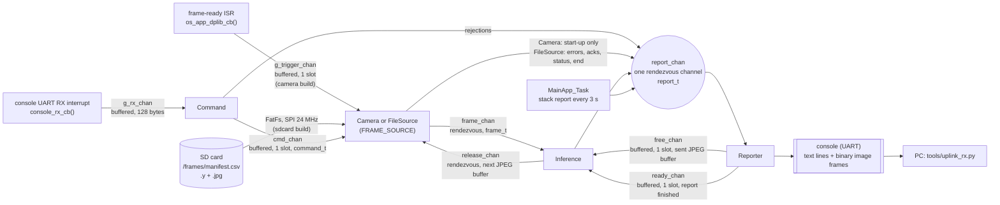

# CSP Neuropathway Image Uplink on Himax WE2

**Two frame sources, chosen at build time:** the frames come from the IMX219 camera (`FRAME_SOURCE=camera`, the default) or from an SD card (`FRAME_SOURCE=sdcard`: `FileSource` reads luma and JPEG files listed in a manifest, for repeatable runs, bit-exact comparison with the model on the PC and labelled evaluation sets). Both sources are processes with the same four channels; everything downstream is unchanged (sections 16-19).

This app extends the person-detection pipeline of [`csp4cmsis_allon_sensor_tflm`](../csp4cmsis_allon_sensor_tflm) (Camera → Inference → Reporter, built from **Communicating Sequential Processes (CSP)** on the Himax WE2, Grove Vision AI V2, with an IMX219 camera). Its goal is to send the best JPEG out of every window of 20 frames to the PC over the existing console UART (921 600 Bd over USB-C), without the camera ever waiting for the link. It uses CSP4CMSIS 3.0.1 on FreeRTOS 10.5.1, through the SDK's CMSIS-RTOS2 adapter (`OS_HAL := y`; the kernel is started with `osKernelInitialize()`/`osKernelStart()`), and the Ethos-U55 NPU.

The work follows a staged plan; each stage must pass on the board before the next starts:
* **Stage 0, retargeting test (gate):** point the JPEG DMA (WDMA2) at a different buffer before each capture and check that the hardware follows (section 7).
* **Stage 1, link:** binary frames from the Reporter, and a PC receiver that saves the JPEGs and prints the text lines.
* **Stage 2, ownership token:** Inference hands the raw frame buffer back to Camera (`release_chan`) once it has rescaled it, so the camera re-arms while `Invoke()` runs. In the uplink build Inference also stops sending a result line per frame and sends one `Window` summary per window (window id, frame range, best frame index and score, windows merged), followed by the window's `Image` report; Camera no longer reports while frames run. Measured against two baselines: 18.47 frames/s (Stage 1) and 19.4 frames/s (the parent app); the target is about 19.4 while images are being sent.
* **Stage 3, best-of-20:** four JPEG buffers in fixed roles (DMA target, being scored, best of the window, being sent); the uplink returns its buffer when the send is done, and a window whose best cannot be sent yet is merged into the next. Inference writes to `report_chan` only while it holds the free token, i.e. knows that the Reporter has finished sending; the `Window` line and the `Image` go together, and a failed inference is counted in the next `Window` line instead of getting a line of its own. Only the start-up lines and MainApp's stack report can still block on the Reporter. A board-side stall (`-DUPLINK_STALL_MS`) makes merging happen; stopping reads on the PC does not slow the board (there is no flow control) and is a separate check that the board carries on. Until Stage 3 nothing can merge, so every `Window` line says `merged 0`; the check with the uplink stalled is where the count must start to rise. Stack high-water marks are taken at the end of the 10-minute run, not shortly after flashing: the selection logic and the non-blocking poll on `free_chan` run in Inference (592/1024 bytes in Stage 2).
* **Stage 4, formal model:** the CSP-M model extended with buffer ids as data. The check that Camera and Inference keep cycling while the uplink is stalled must include `report_chan`, not only the buffer tokens: a stalled Reporter blocks every writer of `report_chan`.

**Status (2026-11-02):** Stages 0, 1 and 2 pass on the board (sections 7, 8 and 9); Stage 3 passes on the board (section 10), and the Stage 4 model holds in ProB (section 6). The first person-detection test run (section 11, 2026-11-03) passed its pipeline and selection checks, but its measurements must be repeated: the scene did not follow the protocol. The PC monitor `uplink_gui.py` is in section 12, image quality in section 13, live sensor tuning from the PC in section 14, on-board person detection with event filtering (the current default: images are sent only on detections) in section 15. The default build is the Stage 3 build extended by sections 14 and 15; `-DUPLINK_STAGE0` builds the Stage 0 test instead. Sections 1-6 describe the network and note what the uplink changes.

**Frame source (2026-11-08):** Stage A (the camera driver kept apart, section 16), the SD read check and an app-local card driver (section 17), FileSource and its frames (section 18), evaluation sets (section 19), the GUI's reader process (section 20) and the frame-source model (section 6) pass on the board and in ProB.

The explanations for this code are in the book; the source files deliberately contain no comments.


## 🏗 Architecture Overview

The system is designed as a **Static Network** of independent processes communicating over synchronous channels. The frame data itself is never copied: it stays in the sensor's buffer, and the channels carry small descriptors -- `frame_t` (frame index, JPEG address and size) and `report_t` -- each copied once, from the writer to the reader.



### 1. Camera Handshake (ISR to Process)
To ensure no frames are dropped or partially read, the system uses a private trigger channel:
* **The ISR:** the sensor data path calls `os_app_dplib_cb` from its frame-end interrupt (`SC_sen_nframe_end_IRQn`, measured on the board). On `SENSORDPLIB_STATUS_XDMA_FRAME_READY` it writes a trigger to a one-slot `BufferedChannel<trigger_t, 1>` through `isrWriter().putFromISR()`.
* **Why not a rendezvous channel:** a rendezvous completes only when writer and reader meet, so the writer must be able to wait for its partner. An interrupt cannot wait, so CSP4CMSIS gives rendezvous channels no ISR writer at all. Before 2.0 the ISR used `putFromISR()` on a rendezvous anyway; when the Camera process was not already waiting, the trigger was simply dropped -- and since Camera re-arms the capture only after a trigger, the camera then stopped for good. The one-slot buffer keeps the trigger until Camera reads it.
* **One slot is enough:** Camera re-arms the capture only after it has read the trigger, so at most one frame-ready can be pending. If a write ever fails, a second frame-ready arrived before the first was read (a driver bug): the callback prints `FATAL: camera frame-ready trigger lost ...` and halts instead of losing the frame silently.
* **Interrupt priority:** an interrupt whose handler calls CSP4CMSIS or FreeRTOS must run at priority 5..7 (`CSP4CMSIS_MAX_SYSCALL_INTERRUPT_PRIORITY` = 5, 3 priority bits); the SDK leaves every interrupt at 0. `Camera::run()` sets `SC_sen_nframe_end_IRQn` to 5 before the data path starts. The NPU interrupt (`U55_IRQn`) gives an RTOS semaphore (point 3), so `cvapp.cpp` sets it to 5 too, before enabling it. The data path's other interrupts (84, 143, 154-157) make no RTOS or CSP4CMSIS calls and stay as they are.
* **The Process:** the Camera process blocks on this trigger, ensuring a lossless, synchronized handshake between hardware and software.
* **Stage 3 (default build):** the handshake is unchanged. Between passing a frame on and re-arming, Camera waits for Inference to release the raw buffer and to name the JPEG buffer for the next capture, and points WDMA2 at it (section 2).
* **Under `-DUPLINK_STAGE0`:** the handshake is the same, but it ends by design after 100 frames. Camera no longer re-arms the capture, so no further frame-ready interrupt comes and Camera blocks on the trigger channel for good (section 2).

### 2. Frame Re-triggering
To prevent buffer overruns and keep the pipeline in lockstep, the Camera process explicitly calls `sensordplib_retrigger_capture()` only **after** the current frame has been successfully passed to the inference stage. This creates natural back-pressure.

**Stage 2: the raw buffer is a token.** There is one raw frame buffer (`demosbuf`), and re-arming the capture hands it back to the DMA. Before Stage 2, Camera re-armed as soon as Inference had taken the frame descriptor, while Inference was still rescaling the raw buffer: the next capture could overwrite it during the rescale, and only the sensor's timing kept that from happening. Now `cv_run()` is split into `cv_prepare()` (rescale the raw frame into the model's input tensor) and `cv_invoke()` (run the model, read the scores). Inference writes a `release_t` on `release_chan` (a rendezvous) between the two, and Camera reads it after `m_frame_out.write(f)` and before `sensordplib_retrigger_capture()`. The raw buffer is therefore written by the DMA or read by Inference, never both, by the order of channel events alone, and the capture still overlaps `Invoke()`. In Stage 2, on the last frame of each window, Camera then called `cisdp_set_jpeg_buf()` for the other JPEG buffer before re-arming (section 8). Whether re-arming after the rescale, instead of at once, still catches the next sensor frame is measured by the frame rate (section 9).

**Stage 3 (default build): the JPEG buffers are tokens too.** There are four JPEG buffers (`CISDP_JPEG_BUF_CNT=4`, set in the `.mk`), each in one role at a time: the DMA target (Camera), being scored (Inference, from `frame_chan` until its score is known), the best of the window so far (Inference), and being sent (the Reporter). `frame_t` carries the buffer id, and `release_t` now carries the id of the buffer for the next capture. Inference keeps the buffers that are in no role in a small array (`spare`) and releases one of them after the rescale, as in Stage 2. One is always there: at that moment Camera holds no buffer (its last target is the frame being scored), and the other three roles take at most three, so with four buffers at least one is spare, whether or not the window has a best and the Reporter is sending. Once the frame is scored, either the old best or the new frame's own buffer joins the spares. Releasing only after `cv_invoke()`, which an earlier version did, made Camera re-arm about 1.6 ms later and cost 1.5 % of the frame rate (19.11 and 19.13 frames/s in two 10-minute runs, section 10).

**Under `-DUPLINK_STAGE0`**, Camera does two more things between passing the frame on and re-arming: it zeroes the other JPEG buffer, takes a CRC32 of the buffer it has just checked, and points WDMA2 at the other buffer (`cisdp_set_jpeg_buf()`), so the buffers alternate from frame to frame. After frame 99 it does not re-arm at all: it reports the verdict, has both buffers dumped and waits for ever, and Inference waits for a frame that never comes (section 7).

### 3. Model Inference
The inference process utilizes the `cvapp` module from the Himax SDK:
* **NPU:** Initialises the Ethos‑U55.
* **Inference blocks during `Invoke()`:** the Ethos-U driver waits for the NPU with a semaphore. Its own bare-metal version spins in `__WFE()` (and `malloc()`s each semaphore); `ethosu_rtos_semaphore.c` replaces it with CMSIS-RTOS2 semaphores whose control blocks are static. While the NPU runs, Inference is blocked and the CPU is free; the NPU's end-of-job interrupt, at priority 5 like the frame-ready interrupt, releases the semaphore and Inference continues. Measured over 60 s (1164 frames): one take per frame; `Invoke()` takes 1.61 ms (642 k cycles at 400 MHz), of which about 1.1 ms was spent spinning before; the CPU's idle share rose from 95.3 % to 97.4 %. The frame rate is unchanged: the camera sets it, not the NPU.
* **Model:** Loads a specialized person‑detection TFLM model.
* **Data Path:** Runs inference on the luma plane of the raw frame, given by the frame source (`frame_t.raw_addr`, `raw_w`, `raw_h`; section 16). `cv_prepare(raw, w, h)` rescales the frame to 96x96 and `cv_invoke()` runs the model; Inference releases the raw buffer between the two (section 2).
* **Windows (Stage 2):** Inference keeps the window's best person score and its frame index. On the window's last frame it sends a `Window` report (window id, first and last frame, best frame index and score, windows merged; always 0 in Stage 2) and then the `Image` report for the window's last frame (frame index, JPEG address and size, window id, the frame's score). A failed `Invoke()` is reported at once (`Frame <n>: inference failed (<code>)`) and does not count for the best score. Under `-DUPLINK_STAGE0` Inference sends the `Window` report but no `Image`.
* **Best-of-20 (Stage 3):** Inference keeps the best frame's descriptor (`frame_t`, with its buffer). Before every frame it polls `free_chan` without blocking: a PRI ALT over the channel and a zero timeout (`Alternative(m_free_in | returned, skip)` with `RelTimeoutGuard skip(Milliseconds(0))`, CSP's SKIP; CSP4CMSIS 3.0.1 has no `tryRead`). A buffer that comes back joins the spares, and Inference holds the free token again. On a window's last frame, if it holds the token, it sends the `Window` line (window id, the first and last frame of the merged range, best frame and score or `-` if every frame failed, windows merged, failed inferences) and then the `Image` report of the best frame, with its buffer id; it then no longer holds the token. If it does not hold the token, it sends nothing: the window is merged, the best and the counts carry over, and the next line it sends covers both windows. A failed `Invoke()` is counted (`failed <k>`); its buffer is free at once. Under `-DUPLINK_STAGE0` the best buffer is put back with the spares instead of being sent.
* **Start-up order:** Inference initialises the model only when its first frame has arrived, i.e. after Camera has started.

### 4. Reporter: the console has one owner
The console is a shared resource, and `xprintf()` has no locking, so two processes printing at the same time tear each other's lines. The **Reporter** is therefore the only process that prints while the network runs. Camera, Inference and `MainApp_Task` send it fixed-size `report_t` messages (`common_types.h`: kind, code, the reporting thread's name -- a string literal, so only the pointer is copied -- frame index, values) over **one rendezvous channel with three writers**; the Reporter owns every format string and prints exactly one line per report: one per window (Stage 2; one per frame before), plus MainApp's stack report every 3 s. For an `Image` report it writes one binary frame instead (section 8). The Reporter has no timer; its only state is the binary frames' sequence number and a count of JPEGs it refused to send.
* **Rendezvous, not buffered:** nothing is lost, and the cost is small: at 921 600 Bd a result line takes about 0.5 ms, against 51.6 ms per frame (19.4 frames/s, measured over 60 s). Before the uplink, Camera reported only at start-up, so its frame loop never waited for the console. A `KeepNewest` buffer would drop reports silently. In Stage 1 the console was a bottleneck once per window: an image takes about 62 ms at 921 600 Bd, Inference waited that long to hand over its next result line, and Camera waited for Inference (section 8). In Stage 2 Inference writes to `report_chan` only twice per window, the `Window` line (about 0.6 ms) and then the `Image` report, which the Reporter takes at once and then sends for 62 ms while nobody but MainApp writes; Camera writes only at start-up. A stalled Reporter would still block Inference at the end of the next window, and Camera behind it. In Stage 3 Inference writes only while it holds the free token, so the Reporter is idle and takes the line at once (or after at most one stack line from MainApp); with the uplink busy, Inference merges instead of waiting. After an `Image` the Reporter returns the buffer on `free_chan`, a one-slot buffered channel, so it never waits for Inference either: only one image is ever out, so the slot is always empty when it writes. Under `-DUPLINK_STAGE0` Camera also sends two reports per frame (the check and the JPEG tail), before it passes the frame on, so the Stage 0 build does wait for the console. `report_t` then also carries 16 bytes for the tail (48 bytes instead of 32; 32 since Stages 2 and 3 added two values for the `Window` report).
* **Before the Reporter's first line**, only MainApp (`CSP_Main: started`, before it builds the network) and the camera driver print (its start-up log, during `cisdp_sensor_init()`/`cisdp_dp_init()`): Inference is still waiting for the first frame, and MainApp sends its first stack report only 3.5 s after start (on the board, Camera reported `started` about 2.9 s before it). The `FATAL` messages are the exception: the frame-ready ISR's, the stack-overflow hook's and the malloc-failed hook's (section 5); each halts the system.

### 5. Memory & Performance
* **Zero Heap:** All CSP channels and processes, every thread's stack, and the Ethos-U driver's semaphores are statically allocated at compile time; the FreeRTOS heap is not used (`configTOTAL_HEAP_SIZE` 1 KB, 0 allocations measured). The C library heap (16 KB, `__HEAP_SIZE` in the linker script) sees two allocations, both at start-up and never freed: 1088 bytes for the C++ runtime's emergency exception buffer (libstdc++, before `main()`) and 12 bytes for the Ethos-U driver's device structure (`ethosu_dev_init()`, when Inference initialises the model); 1112 bytes in use including `malloc()`'s bookkeeping (`mallinfo()`), and no allocation while frames run.
* **Frame buffers:** all in `.bss.NoInit`. Since Stage A (section 16) the raw buffer (YUV420 at 640x480, 460 800 bytes, read by Inference; `demosbuf` before) and the `jpegbuf` array of `CISDP_JPEG_BUF_CNT` JPEG buffers are in `frame_buffers.c`; the driver keeps only `jpegfilesizebuf` (100 bytes; the encoder writes the JPEG size here). Each JPEG buffer is `JPEG_BUFSIZE` rounded up to a multiple of 32, so that cache maintenance on one buffer never touches its neighbour: 115 856 bytes at 640x480 with the encoder's 4x table (section 13; 46 256 with the 10x table before), i.e. 115 872 bytes per buffer. The driver's default for `CISDP_JPEG_BUF_CNT` is 2; the `.mk` sets 4 (463 488 bytes; 185 088 with the 10x table) for Stage 3 (section 2). The Stage 0 build alternates buffers 0 and 1 only.
* **SRAM:** 1349 KB of 1924 KB used (70.1 %, from the linker), with 4 JPEG buffers sized for the 4x table (section 13); 1077 KB (56.0 %) with the 10x table, about 136 KB more than with the single `jpegbuf` (987 KB with 2). The largest items are `demosbuf`, the model (251 568 bytes) and the tensor arena (128 000 bytes).
* **Overflow and heap checks:** `configCHECK_FOR_STACK_OVERFLOW` is 2, so FreeRTOS checks each task's stack at every context switch. `vApplicationStackOverflowHook()` prints `FATAL: stack overflow in task <name>`, `vApplicationMallocFailedHook()` prints `FATAL: pvPortMalloc() failed in task <name>` (or `(scheduler not started)`), and `vAssertCalled()` prints the file and line. All three use `xprintf()`, not the C library's `printf()`, and then halt.
* **Concurrency:** Each process runs in its own thread (`osPriorityLow2`), created by `Run(..., ExecutionMode::StaticNetwork)` from `MainApp_Task` (`osPriorityLow3`).
* **Console output:** one line per window (Stage 2; one per frame before), printed by the Reporter only (before, each result was printed twice, by Inference and by a Console process, and lines from different processes interleaved mid-string).

### 6. Formal Model
[`Formal model/`](Formal%20model/) holds a CSP-M model of the parent network (Camera → Inference → Reporter, one report channel with three writers: Camera, Inference and MainApp), checked with ProB 1.16.1: deadlock and divergence freedom; refinement against a specification of the console's pipeline lines (the camera driver's log, the two `started` lines, then exactly one result line per frame, in frame order) and of its stack lines (complete groups, for ever); and, with Inference stalled, no deadlock and an unchanged stack report. Three positive controls fail as they should: a Reporter that reads per-writer channels in a fixed order (deadlock), an Inference that also prints (specification violated), and the previous design with the stack report in the Reporter (the stack report stops when the pipeline stalls).

That model, `Neuropathway.csp`, covers the network as it was before the uplink.

**Stage 4: the uplink model.** `Uplink.csp` models the Stage 3 network with the four JPEG buffer ids as data: `frame_chan` carries the frame's buffer, `release_chan` the next DMA target, the `Image` report the buffer to send, and `free_chan` (one slot; Inference's PRI ALT with a zero timeout modelled exactly) brings it back. To keep the state space small it uses windows of 2 frames instead of 20, frame indices 0..3 and a merged count that saturates at 2. Checked with ProB 1.16.1, 7 of 7 assertions hold: deadlock and divergence freedom; the four ids always form a permutation across the roles next, pending, best, sending and spare (an observer follows every id through the events), Camera is only handed a spare, only the best is sent, and `free_chan`'s slot never overflows; every `Window` line carries the number of windows merged since the last; with the Reporter stalled for ever after any image, Camera and Inference keep cycling, with `report_chan` and MainApp in the model; and after a stall only the merges go on, one per window. Two positive controls fail as they should: Camera retargeted to the best buffer (the observer finds the best handed out as a DMA target), and Inference writing to `report_chan` without the free token (with the Reporter stalled, Camera stops). Details in [`Formal model/readme.md`](Formal%20model/readme.md). Not modelled: timing, the JPEG contents and the D-cache, and the Stage 0 build.

**Since sections 14 and 15: two models.** The model now covers the ready token and the per-frame `Scores` reports (`Uplink.csp`, definitions in `Uplink_defs.csp`) and, apart, the command path (`Uplink_command.csp`): one model of both ran out of memory. 9 of 9 and 11 of 11 assertions hold: deadlock and divergence freedom; the buffer permutation (now with suppressed windows and both one-slot channels); the merged count; Inference's reports and the ready token alternate; and Camera and Inference keep cycling with the Reporter running or stalled and, in the command model, whether or not commands arrive. The cycling checks now use failures-divergences refinement with MainApp limited to two reports: with failures refinement and an unbounded MainApp, the stack reports form a loop of hidden events that hides a blocked Camera (control 3 passed that way at first). Four positive controls fail as they should, among them Inference writing `Scores` without the ready token (Camera stops when the Reporter stalls). Details in [`Formal model/readme.md`](Formal%20model/readme.md).

**Since section 18: the frame source.** `Uplink_source.csp` (definitions in `Uplink_source_defs.csp`) models the network with either source. `frame_chan` carries a kind, a frame or the end-of-stream terminator, and Inference flushes a partial window at end of stream. The argument that one model covers both sources is a refinement. `SOURCE(b)` is the source protocol: send a frame or a terminator in the buffer last given, then accept any buffer as the next. Camera and FileSource both refine it in failures-divergences, with everything but `frame_chan` and `release_chan` hidden. The card reads, CRC checks and pace are internal to FileSource, and `cmd_chan` is the same for both. So Inference and the rest of the network cannot tell the sources apart on those channels, except through `report_chan`, which the model includes.

With FileSource, 11 of 12 assertions hold, and the remaining one fails by design:
* deadlock and divergence freedom;
* the buffer permutation, with the terminator's buffer going back to the spares;
* the merged count;
* the alternation of reports and ready tokens;
* frames and terminators keep flowing while the Reporter runs.

The Camera network with the new Inference keeps cycling with the Reporter stalled. The check that fails by design is FileSource cycling with the Reporter stalled. FileSource reports between frames (errors, acknowledgements, status, end of stream), and the end-of-stream flush waits for the ready token. On an SD card that costs no frames; a camera would miss sensor frames, which is why Camera reports only at start. Two positive controls fail as they should: a flush that sends its image without the free token breaks the buffer roles, and a FileSource that does not wait for a release after the terminator breaks the protocol. Not modelled: the card driver's timing and the ALT guard-slot issue (section 18), which is a property of the library's implementation, not of the channel protocol. Details in [`Formal model/readme.md`](Formal%20model/readme.md).

### 7. Image Uplink, Stage 0: retargeting the JPEG buffer (gate test)
The uplink design keeps several JPEG buffers and points WDMA2 at a different one before each capture. Stage 0 checks that the hardware follows before anything is built on it.
* **The library setter is not enough.** `sensordplib_set_xDMA_baseaddrbyapp()` only stores the three addresses in the library's own variables (`g_dp_wdma1/2/3_addr`). The WDMA2 address reaches the hardware (the WDMA2 start-address register, xDMA offset `0x44`) only when the data path is set up, through `hx_drv_xdma_set_WDMA2allCfg()` inside `cisdp_dp_init()`. `sensordplib_retrigger_capture()` never reads the stored addresses: the disassembly of `libsensordp.a` shows that it only re-enables the stream, clears the INP software reset, re-arms the xDMA watchdog and sets the sensor control's clock and reset. `cisdp_set_jpeg_buf(id)` therefore writes the register itself with `hx_drv_xdma_set_WDMA2Addr()`. It also updates `g_wdma2_baseaddr`, which `cisdp_get_jpginfo()` reads, and the library's copy, so a later data-path setup uses the same buffer.
* **Why the reported address alone proves nothing:** with `cyclic_buffer_cnt = 1`, `cisdp_get_jpginfo()` computes the JPEG address from `g_wdma2_baseaddr` (slot 0), i.e. from the software variable, whatever the DMA did. The test therefore checks five things for every frame, one bit each in `flags`:
  * 1: `jpeg_addr` from `cisdp_get_jpginfo()` is the target buffer;
  * 2: the WDMA2 register reads back the target buffer (`cisdp_get_wdma2_hw_addr()`);
  * 4: the target buffer starts with a JPEG SOI (`FF D8`). Camera zeroed the whole buffer before the capture, so only the DMA can have put it there;
  * 8: a JPEG EOI (`FF D9`) ends where the encoder's padding rule (below) says it must;
  * 16: the other buffer is unchanged: its CRC32, taken just before the retrigger, is the same at frame-ready. The DMA wrote into the target buffer and nowhere in the other one.

  `flags 1f` (all five) is a pass.
* **The encoder pads the reported size.** The size from `cisdp_get_jpginfo()` is not the JPEG's length: it is the length (up to and including the EOI) rounded up to a multiple of 4, plus 32. The EOI therefore ends 32 to 35 bytes before the reported size. On the board, over two runs of 100 frames (sizes 5656-5692 bytes), the EOI ended 32, 33, 34 or 35 bytes before the size, always as the rule predicts; the last 16 bytes were zero every time, there was no EOI after the size, and the DMA's last non-zero byte was the EOI itself. Camera zeroes the buffer before each capture, so whether the encoder writes the padding (as zeros) or leaves it untouched is not known; without the zeroing it may hold bytes from an older frame. An earlier check that allowed only 0-3 bytes of padding failed on every frame (`flags 7`). The uplink must send only the JPEG itself, up to the EOI; decoders accept the padded size too, since they stop at the EOI.
* **Diagnostics:** for each frame Camera also prints a tail line, `Camera: frame ... buf ... tail <16 bytes> eoi_back <k> eoi_fwd <d> dma_end <e>`: the 16 bytes before the reported size; `eoi_back`, the distance from the start of the last EOI to the reported size, searching back up to 64 bytes (2 means the EOI ends exactly at the size); `eoi_fwd`, the offset of the first EOI at or after the size, up to 64 bytes on; and `dma_end`, the end of the last non-zero byte in the buffer, relative to the size. Because Camera zeroes the whole target buffer before each capture, nothing after the EOI can be left over from an older frame. `stage0_capture.py` summarises the three values over the run.
* **Run:** build with `-DUPLINK_STAGE0` (set in the `.mk`). Camera alternates buffers 0 and 1 for 100 frames and prints two lines per frame, the check line `Camera: frame ... buf ... jpeg_addr ... wdma2 ... size ... flags ... ok|FAIL` and the tail line, then `Camera: STAGE0 PASS|FAIL (n of 100 frames ok)`. It then stops the capture, so that neither buffer changes while it is printed, and the Reporter dumps both buffers as hex (`JPEG BEGIN` ... `JPEG END`). On the PC, `python3 tools/stage0_capture.py --port /dev/ttyACM0 --out stage0` checks the lines and writes `stage0_buf0_frame98.jpg` and `stage0_buf1_frame99.jpg`, decoding them if Pillow is installed (`--log <file>` reads a saved console log instead). Opening the port resets the board, so the capture sees the run from the start; if `uplink_rx.py` has parked the port (section 8), run `uplink_rx.py --unpark` first.
* **Pass:** the board prints `PASS (100 of 100 frames ok)`, both images decode, and they differ. If bit 2 fails, WDMA2 does not take the new address, and the design changes.
* **Result (2026-11-02):** PASS. 100 of 100 frames had `flags 1f`; both JPEGs decode (640x480, 5664 and 5660 bytes). The zeroing and the two CRC32 passes over 46 KB per frame make the Stage 0 build's frame rate unrepresentative; it was not measured.

### 8. Image Uplink, Stage 1: the link
Stage 1 sends the last frame of every window of 20 frames to the PC, without selection, over the console UART. It tests the framing, the receiver and the console with text and binary data mixed.
* **Binary frame** (little-endian): magic `A5 5A 'I' 'M'`, type (u8, 1 = image), reserved (u8, 0), sequence number (u16, +1 per frame), length (u32) of the body, the body, and the CRC32 (as in zlib) of the body. An image body is the metadata, frame index (u32), score (i8, 0 until Stage 3) and window id (u32, frame index / 20), followed by the JPEG. Text lines contain no byte `A5`, so the receiver finds the frames by their magic.
* **Only the JPEG itself is sent:** the Reporter invalidates the D-cache over the reported size, then takes the length up to the EOI with `jpeg_length()` (`uplink.cpp`): the EOI must end 32 to 35 bytes before the reported size (the padding rule, section 7). If it does not, the Reporter sends nothing and prints `Uplink: frame <n> not sent: no EOI 32-35 bytes before size <s> (<k> EOI errors)`, so a change in the encoder cannot slip through.
* **The buffer being sent is never the DMA target:** Camera captures into one JPEG buffer until the window's last frame, sends the `Image` report for it, and switches WDMA2 to the other buffer before re-arming. The next switch back comes after the next `Image` report, and that rendezvous completes only when the Reporter takes it, i.e. after it has finished sending the previous image (it handles one report at a time). So no timing assumption is needed, only the order of the channel events. Stage 2 gives this up (section 9).
* **Only the Reporter writes to the UART:** it writes the frame's bytes with `xfunc_out()`, the console's byte output under `xprintf()`, bypassing `xputc()`'s `\n` → `\r\n` translation.
* **Opening the port must not reset the board.** The Grove Vision AI V2's USB bridge (WCH CH343, Linux driver `cdc_acm`) resets the WE2 on a rising edge of RTS; DTR and a falling RTS have no effect (tested on the board). Linux raises DTR and RTS inside `open()` whenever the port's stored baud rate is not B0, before a program can lower them, so setting `dtr = rts = False` before `open()` (as pyserial allows) still resets the board. `cdc_acm` keeps a port's settings between opens, and when the baud rate then changes from B0 to 921 600 it raises only DTR. `uplink_rx.py` therefore sets the port to B0 ("parks" it) when it exits; its next `open()` leaves RTS low and the app keeps running (tested: three reopens in a row continued at frames 101, 212 and 324, no bootloader banner). The first open after another program (the flasher, a terminal) still resets the board once; `uplink_rx.py --park` does that step on its own. The flasher relies on the reset at open to catch the bootloader, so run `uplink_rx.py --unpark` before flashing (or press the reset button).
* **Run:** `python3 tools/uplink_rx.py --port /dev/ttyACM0 --duration 600 --out images` prints the text lines, saves each JPEG as `w<window>_f<frame>_s<seq>.jpg`, checks its markers (and decodes it, if Pillow is installed), and every 30 s prints a summary: images, CRC errors, sequence gaps, decode failures, EOI errors reported by the board, board resets (a bootloader banner in the stream) and the frame rate, taken from the frame indices in the text lines and the PC's clock (in Stage 1 the `Frame <n>:` lines; since Stage 2 the last frame of each `Window` line).
* **Pass:** over 10 minutes, no CRC error, no sequence gap, every image decodes, no EOI error, text lines readable, and no reset when the receiver starts (the first frame it sees is not frame 0, and no bootloader banner).
* **Result (2026-11-02, clean build with GCC 13.2):** PASS. The receiver started with the app already running (first frame seen 1412, no bootloader banner) and ran for 600 s: 554 images (0.92/s), 0 CRC errors, 0 sequence gaps, 0 bad frames, every image decoded (640x480, 5613-5685 bytes up to the EOI), 0 EOI errors, 11 880 text lines.
* **Frame rate:** 18.47 frames/s over frames 1412-12495 (PC clock), against the 19.4 frames/s baseline: 4.8 % lower. This is the Reporter's 62 ms per image: Inference waits that long for its result line once per window, Camera waits for Inference, and about one frame period is lost per 20 frames (19.4 × 20/21 = 18.5). Stage 2 is measured against 18.47 frames/s.
* **Stacks after 10 minutes:** Camera 776/1536 bytes, Inference 608/1024, Reporter 472/1024, CSP_Main 600/1024 (464 bytes before it printed `CSP_Main: started`).

### 9. Image Uplink, Stage 2: the raw buffer as a token, one report per window
Stage 2 makes the raw frame buffer an explicit token (`release_chan`, section 2) and takes the console off the camera's path: Inference sends one `Window` line and one `Image` report per window instead of a result line per frame, and Camera reports only at start-up (sections 3 and 4). The frame sent is still the window's last, not its best.
* **Console:** `Window <w>: frames <a>-<b> best <f> score <s> merged <m>` once per window, followed by the image of the window's last frame; the image's metadata now carries the frame's score. `uplink_rx.py` checks that each window starts one frame after the previous one ended, and counts `inference failed` lines as failures. (Stage 3 adds `failed <k>` and sends the best frame, section 10.)
* **The JPEG buffer being sent is protected by timing again, not by channel order.** In Stage 1 Camera sent the `Image` report itself, so its switch back to a buffer waited until the Reporter had taken the next report, i.e. had finished sending. Now Inference sends the `Image` report for frame 20w+19 after Camera has already switched WDMA2 to the other buffer and re-armed. Camera switches buffers only on a window's last frame (`f.index % 20 == 19`); the per-frame alternation is the Stage 0 build's alone. Frames 20w+20 to 20w+39 therefore go to the other buffer, and the sent buffer is next written by the capture of frame 20w+40, which starts when Camera re-arms after frame 20w+39: 20 frame periods, about 1.03 s, after the `Image` report, against about 62 ms for the send. Nothing orders the two; the margin is about 0.97 s. Stage 3's `free_chan` (the uplink returns the buffer when the send is done) restores an argument from channel order alone.
* **What still blocks:** the Reporter takes the `Image` report at once, because nothing else writes to `report_chan` near the end of a window except MainApp's stack lines (a few ms). If the Reporter were stalled for longer than a window, Inference would block on the next `Window` line and Camera behind it; the Stage 4 check of Camera and Inference cycling with the uplink stalled must therefore include `report_chan`.
* **Run and pass:** as Stage 1 (section 8), plus no window gap and no inference failure.
* **Result (2026-11-02, clean build with GCC 13.2):** PASS. The receiver started with the app running (first window seen ended at frame 519, no bootloader banner) and ran for 600 s: 582 images (0.97/s), one per window, 0 CRC errors, 0 sequence gaps, 0 bad frames, every image decoded (5503-5524 bytes), 0 EOI errors, 582 windows with 0 gaps, 0 inference failures.
* **Frame rate:** 19.39 frames/s over frames 519-12139, against 18.47 frames/s in Stage 1 (+5.0 %) and the 19.4 frames/s baseline of the parent app (the same within the measurement). So the image no longer costs a frame per window, and re-arming after the rescale instead of at once still catches the next sensor frame: the rescale (96x96 outputs) is short against the frame period of 51.6 ms. The second raw buffer, the fallback in the plan, is not needed.
* **Stacks (20-second check after flashing):** Camera 776/1536 bytes, Inference 592/1024, Reporter 488/1024, CSP_Main 688/1024.

### 10. Image Uplink, Stage 3: best-of-20 with buffer tokens
Stage 3 sends the best frame of each window, by person score, and never makes Camera or Inference wait for the uplink. The four JPEG buffers and their roles are in section 2, the selection, the free token and merging in section 3, and why nothing but MainApp and the start-up lines can block on the Reporter in section 4.
* **The buffer being sent is protected by channel order again.** The Reporter gets a buffer only with an `Image` report and gives it back on `free_chan` when the send is done (or refused); until Inference has read it back, the buffer is in no other role, so Camera cannot be handed it as a DMA target. The ~0.97 s timing margin of Stage 2 (section 9) is no longer needed.
* **Console:** `Window <w>: frames <a>-<b> best <f> score <s> merged <m> failed <k>`, then the image of frame `<f>`. `<a>-<b>` spans `<m>+1` windows; `best - score -` if every frame in it failed (no image then). Failed inferences no longer print a line of their own.
* **Stall build:** `-DUPLINK_STALL_MS=<ms>` (commented out in the `.mk`) makes the Reporter sleep that long after each image before returning the buffer, so the uplink stays busy for the send plus the stall. Stopping reads on the PC cannot do this: the console has no flow control, so the board keeps sending and the USB bridge drops what the PC does not read.
* **Receiver:** `uplink_rx.py` also checks that every image is the frame, score and window that the `Window` line before it names, and counts merged windows and failed inferences. `--pause <start> <seconds>` stops reading with the port open and then resynchronises (losses in the first 2 s after are counted separately), for the receiver-stopped check. It keeps the last stack line of each thread for the summary.
* **Pass:** as Stage 2, plus every image is its line's best; with `UPLINK_STALL_MS=1500` the frame rate stays at about 19.4, `merged` rises, and every image is intact; with the receiver stopped for two minutes the board's frame rate across the pause is unchanged.
* **Results (2026-11-02, clean builds with GCC 13.2, 10-minute runs unless stated):**
  * **Default build:** PASS. 581 images, one per window, each the best of its window, all decode (5426-5518 bytes); 0 CRC errors, 0 sequence gaps, 0 EOI errors, 0 window gaps, 0 merged, 0 failed inferences. 19.39 frames/s (Stage 2: 19.39, parent app: 19.4). The best frame was at every position in the window; position 0 most often (56 times) and 19 least (18), because the scene was static, scores often tied, and the first of equal scores is kept.
  * **Stall build, `UPLINK_STALL_MS=1500`:** PASS. 19.39 frames/s; 291 lines covering 582 windows with 0 gaps, every line `merged 1` (the uplink is busy about 1.56 s per image and a window lasts about 1.03 s, so every second window end finds the token back); 291 images, each the best of its two-window range, all intact.
  * **Receiver stopped (default build, 300 s run, no reads for 122 s from 60 s on, port open):** PASS. Across the pause the board went from frame 13199 to 15559, 19.41 frames/s; after it the receiver lost one partial frame while resynchronising and found no errors.
  * **Releasing after `cv_invoke()` on every frame** (an earlier version, see section 2): PASS, but 19.13 and 19.11 frames/s in two runs, 1.5 % slower.
* **Stacks at the end of the 10-minute runs:** Camera 784/1536 bytes, Inference 736/1024 (720-760 across the Stage 3 runs: 264 bytes of headroom at worst, against 432 in Stage 2), Reporter 488/1024 (504 in the stall build), CSP_Main 784/1024.
* **SRAM:** 1077 KB of 1924 KB (56.0 %).
* **Stage 4 changes to the firmware:** the merged count saturates at `INT16_MAX` (the model found that it would otherwise overflow after 32 767 merged windows, about 9.4 hours of stall), and Inference's stack is 1536 bytes instead of 1024. Checked on the board for 3 minutes: PASS, 174 images, each its window's best, 19.41 frames/s, Inference 736/1536 bytes.

### 11. Person detection test: scores with a person in view
The first run with real content: what the person score does with a person in view, whether best-of-20 picks the right frames, and the numbers needed to choose an event-gating threshold later. This is a measurement, not a claim about the model's accuracy; there is no gating yet.
* **Score-log build:** `-DUPLINK_SCORE_LOG` (commented out in the `.mk`) appends the window's 20 person scores and 20 no-person scores to the `Window` line: `... merged 0 failed 0 p <p0> .. <p19> n <n0> .. <n19>`. The 40 values do not fit in `report_t`, so the `Window` report carries a pointer (`scores`) to one of two static score blocks owned by Inference. Inference fills a block during the window and switches to the other block each time it sends a `Window` report. A block is therefore written again only after the next `Window` report has been sent, and that rendezvous completes only when the Reporter reads it, i.e. after it has printed the previous line. The free-token rule alone would not do: when every frame of a window fails there is no `Image` report after the line, and nothing would make Inference wait for the Reporter before it starts to fill the block again. The line is about 220 characters per second, against 92 kB/s.
* **Receiver and analysis:** `uplink_rx.py` writes `windows.csv` (window, first, last, best, best_score, merged, failed, t_pc, p0..p19, n0..n19) and `images.csv` (window, frame, score, seq, file, bytes, decoded) next to the images. `--prompts tools/phases.csv` prints the operator's prompt for each step of the protocol at its start time (and a warning 10 s before) with the elapsed time, and copies the table to the output folder. `tools/analyse_run.py <run>` assigns each window to the phase at its midpoint and leaves out windows that start less than 5 s after a phase change (`--settle`). It prints, and writes to `analysis.txt`: per phase and per prompt step, the person-score distribution over frames and over the window bests and the fraction of frames with person > no-person; the best-frame check (the logged best is the first maximum of p0..p19, and the saved image has that frame and score); the histogram of the best frame's position; the drift between the empty phases; the margin between the empty phases' highest window-best and the `stand` phase's lowest; a threshold table; and a contact sheet per phase, `sheet_<phase>.png`.
* **Protocol** (`tools/phases.csv`): fixed camera, constant light, scene clear at the start; 0:00-2:00 `empty_1` (nobody in view), 2:00-4:00 `walk` (walk across about 3 m away, every 15 s), 4:00-6:00 `stand` (2 m, 1 min facing, 1 min side-on), 6:00-8:00 `distance` (1, 3 and 5 m, 40 s each), 8:00-10:00 `empty_2`.
* **Result, run 1 (2026-11-03, clean build with GCC 13.2, `-DUPLINK_SCORE_LOG`, 600 s):**
  * **Pipeline: PASS.** 582 images, one per window, all decode (5491-10 114 bytes); 0 CRC errors, 0 sequence gaps, 0 bad frames, 0 EOI errors, 0 window gaps, `merged 0` throughout, 0 failed inferences, no reset. 19.39 frames/s with the log on (19.39 without). Stacks at the end: Camera 784/1536 bytes, Inference 752/1536, Reporter 512/1024, CSP_Main 784/1024. SRAM 1077 KB of 1924 KB (56.0 %).
  * **Selection: PASS.** In 582 of 582 windows the logged best is the first maximum of the 20 logged scores, and the image's frame and score match. 104 windows had a tied maximum, and the first of them was kept.
  * **Measurements: not valid, repeat the run.** The contact sheets show that the scene did not follow the protocol. The camera was not fixed (the view turns between the room, its window, the wall and the ceiling), and the operator was in view, close to the camera and seen from below, in almost every window of `empty_1` and in the first 30 windows of `empty_2`; the 1, 3 and 5 m steps of `distance` look the same. Most of `empty_2` (from window 901 on) is a nearly black, uniform image, as if the lens were covered. The images are dark throughout. The per-phase figures therefore describe the labels, not the scene: by label, `empty_1` has the highest window-best scores of the run (median 71, maximum 116), `empty_2` has drifted far from it (median of the frames 44 → -14), the margin between the empty phases' highest window-best and `stand`'s lowest is -143, and no threshold separates the "empty" windows from the "person" ones. None of these may be used to choose a threshold.
  * **What the sheets do show, grouped by content** (windows chosen from the contact sheets by eye, so the groups are approximate):

    | Scene | Windows | Window-best score: min / median / max | Frames: min / median / max |
    |---|---|---|---|
    | wall or ceiling, nobody in view (`stand`, w639-660) | 22 | -27 / -23 / 3 | -34 / -27 / 3 |
    | nearly black, uniform (`empty_2`, w905-981) | 77 | -13 / -10 / -7 | -21 / -14 / -7 |
    | operator in view, close, facing (`stand`, w663-749) | 87 | 10 / 64 / 90 | -59 / 48 / 90 |
    | operator in view, close, very dark (`distance`, w755-865) | 111 | -5 / 45 / 72 | -50 / 30 / 72 |
    | operator at the edge, partly cut off (`walk`, w557-578) | 22 | -75 / -40 / 9 | -92 / -64 / 9 |

    With a face in view the window-best was mostly 40-100; without a person it stayed at 3 or below; with the person only partly in the frame it was lower still (down to -75). Views of the room where part of the operator, out of focus, fills a corner of the frame scored up to 116. The no-person score was always the negative of the person score (the model's two outputs sum to 0), so person > no-person just means a person score above 0.
  * **Best frame's position in the window:** U-shaped, 55 at position 0 and 50 at position 19 against 14-38 elsewhere (34 and 50 counting windows with a unique maximum only). This is what a score that drifts across a window produces, since its maximum then falls at one end; the extra hits at position 0 are the ties. The mean person score by position shows no step at a window boundary (within ±1).
* **For the repeat:** mount the camera so that it cannot move, light the scene well, start with the operator out of view, and check the first contact sheet before reading any figures.

### 12. Uplink monitor (PC GUI)
`tools/uplink_gui.py` shows, in one window, the latest image (green border when the window's best is at or above the person threshold, grey otherwise), the last 10 images as thumbnails (click one to show it large; "Follow latest" returns to the newest; optionally only images at or above the threshold), the link statistics (once per `Window` line: elapsed time, frames/s, images, CRC errors, sequence gaps, EOI errors, window gaps, decode failures, merged windows, failed inferences), the detection statistics (windows at or above the threshold, current and longest run of consecutive ones), the latest stack lines, a plot of the window-best probability over the last 5 minutes with the threshold, and, in the score-log build, the 20 frame probabilities of the latest window with the selected frame highlighted. Below is the console (all text lines, errors in red; Pause, Clear, hide `Window` lines; at most 5000 lines). PC side only, no firmware change.
* **Threshold and probability:** the model's output tensor (`MobilenetV1/Predictions/Reshape_1`, int8, shape [1, 2]) has scale 0.00390625 (1/256) and zero point -128, read from the model's flatbuffer (`person_detect_model_data_vela.cc`). A score s is therefore the probability p = (s + 128) / 256, and since the two probabilities sum to 1 the no-person score is always -s, as run 1 showed (section 11). 50 % is s = 0, i.e. person score >= no-person score. The GUI shows p in percent next to the raw score; the threshold (default 50 %, steps of 0.5 %) is a display and statistics setting only, a window counts when p >= threshold (score >= ceil(256 p - 128)). Gating in the firmware comes later.
* **Structure:** the protocol code is in `tools/uplink_proto.py` (port open/park/unpark, the frame parser with its CRC and sequence checks, the JPEG marker and decode checks, the `Window` and stack line parsers including the score log, the run statistics, the recorder and a `Session` that ties them together); `uplink_rx.py` and `uplink_gui.py` both use it. In the GUI a reader thread does the serial I/O (or the replay) and the parsing and puts events on a queue, and the Tk main loop drains it every 50 ms; only the reader thread touches the port. Disconnect parks the port, as `uplink_rx.py` does on exit.
* **Recording:** with Record on, the run goes to the output folder as with `uplink_rx.py`: the JPEGs, `windows.csv`, `images.csv` and `console.log` (every text line, image and receiver message with the seconds since the start; `uplink_rx.py` now writes it too). `analyse_run.py` reads the folder (with a `phases.csv`) and also prints the number of windows at or above 50 %.
* **Run:** `python3 tools/uplink_gui.py` (pick the port, Connect), or `python3 tools/uplink_gui.py --port /dev/ttyACM0 --connect --record --out run2`. Replay: `python3 tools/uplink_gui.py --replay run_person1 --speed 10` plays `console.log`, or `windows.csv` and `images.csv` for folders recorded before `console.log` existed; the speed can be changed while it plays. Connect and Disconnect are logged, and replay resynchronises at a Connect as the live reader did.
* **Checks (2026-11-03):**
  * **Replay of run 1** (`windows.csv` + `images.csv`): 582 images, 0 errors, 453 of 582 windows at or above 50 % (score >= 0), the same as `analyse_run.py`; at 70 % (score >= 52) 239 of 582, the same as a count from `windows.csv`.
  * **Live, 5 minutes, score-log build, Record on, Disconnect at 150 s and Connect at 156 s:** 290 images, 0 CRC errors, 0 sequence gaps, 0 EOI errors, 0 window gaps, 0 decode failures, every image its window's best, no board reset across the reconnect, 19.39 frames/s. The delay from the reader thread to the screen stayed flat: at most 199 ms in the first minute (start-up), then 126-132 ms per minute. The scene was dark and empty (window-best about 42 %, no window at or above 50 %). The replay of this recording (`console.log`) gives the same counts, and `analyse_run.py` finds 289 of 289 windows correct.
  * **`uplink_rx.py` after the refactor:** 60 s each with the old and the new version: both PASS, same summaries (58 and 57 windows, 0 errors, 19.38 and 19.39 frames/s) and the same line formats. Both print the tail of the image in progress when the port opens as text lines, as before.
  * Not tested automatically: clicking thumbnails, the threshold slider, the "only at or above" filter, Pause, Clear and hiding `Window` lines (the threshold logic itself was checked through `--threshold`).

### 13. Image quality
The images of run 1 are dark, green and blocky. The causes are in the sensor set-up (`cis_sensor/cis_imx219/cisdp_cfg.h`): a fixed exposure (`0xA40` lines), analogue gain `0x40` (about 1.33x), digital gain `0x200` (2x) and no auto-exposure; the raw Bayer data gets no white balance or gamma; and the JPEG encoder ran with `JPEG_ENC_QTABLE_10X` (about 5.6 KB per 640x480 frame, 0.15 bit per pixel). The GUI made it worse by scaling the image about 2.1x.
* **GUI display (PC only):** the image is shown at 1:1, or at the largest integer scale that fits next to the right-hand column (2x from about 1840x1100 on; below 1:1, 1/2), never stretched; the thumbnails are a tenth of its width. The statistics, the two plots and the console are in one column to the right, so everything is visible at 1920x1080 and at 1366x768 (checked in replay of run 1 at both sizes). "Display correction" (on by default, `--no-correction` to start without) applies a gray-world white balance (each channel scaled to the mean of the three channel means) and gamma 2.2 to the displayed image and thumbnails only; the saved JPEGs stay exactly as received.
* **JPEG quality (firmware):** `DP_JPEG_ENCQTABLE` is `JPEG_ENC_QTABLE_4X` (`cisdp_cfg.h`); the quantisation tables in the JPEG headers are about half those of the 10x table (first luminance entries 13, 9, 8 instead of 27, 18, 17). `JPEG_BUFSIZE` follows the SDK's size rule for YUV420 at 4x, `((623 + (W/16)(H/16) 96 + 35) >> 2) << 2` (header of `cisdp_cfg.h`), 115 856 bytes at 640x480 instead of 46 256 for 10x; SRAM 1349 KB of 1924 KB (70.1 %), 272 KB more. The DMA has no length limit, so a frame larger than its buffer would run into the next one, possibly the one being sent; the SDK rule keeps a margin for brighter, more detailed scenes than seen so far. The PC side accepts frame bodies up to 128 KB (`MAX_BODY` in `uplink_proto.py`, 64 KB before).
* **Measured with 4x (2026-11-03, score-log build, 9 minutes in four runs: 3 minutes of a dark, nearly uniform view and three 2-minute runs with the operator and the room in view):** 526 images, each its window's best, all decode; 0 EOI errors, so the padding rule of section 7 (EOI 32-35 bytes before `jpeg_sz`) still holds; 0 window gaps, `merged 0`, 0 failed inferences, no reset; 19.39-19.40 frames/s. Image size min 5775, median 9120, max 16 061 bytes (0.24 and 0.42 bit per pixel; 10x: about 5.6 KB on similar scenes in run 1); the largest frame's `jpeg_sz` is at most 16 096 bytes, a seventh of the buffer (and within the old 46 256 too). Link time per image at 921 600 Bd (10 bits per byte): 62.7 / 99.0 / 174.3 ms, against 1.03 s per window. Only images that are sent are measured, one frame in 20; at the buffer's full 115 856 bytes an image would take 1.26 s, longer than a window, and windows would merge.
* **Analogue gain test (2026-11-03): not valid, repeat.** Three 2-minute runs with the 4x table at `IMX219_AGAIN_SETTING` 0x40, 0x80 and 0xC0 (gain 256 / (256 - X): 1.33x, 2x, 4x; digital gain 2x in all three), the operator to stand at about 2 m in the second minute. Each run passed on the link (117 images, each its window's best, 0 errors, `merged 0`, 19.39-19.40 frames/s). The scene did not stay the same: the contact sheets show the camera moved between and within the runs (a different part of the room at 0x80, a rotated frame at 0xC0), and the operator was in view, mostly close to the camera, from about 17 s (0x40) and 34 s (0xC0) on, i.e. in the minute meant to be empty. The figures below (Y plane from the JPEGs on the PC, decoded as YCbCr, over the images of 5-60 s; noise as the standard deviation of the difference between consecutive images, divided by the square root of 2; window-best score over 65-120 s) therefore compare different scenes, not gains, and the default stays 0x40:

    | Analogue gain | Y mean | Y p5 / p95 | Frame-to-frame noise (Y) | Window-best score, median | JPEG median |
    |---|---|---|---|---|---|
    | 0x40 (1.33x) | 60.5 | 40 / 87 | 7.6 (operator moving) | 58 | 8889 bytes |
    | 0x80 (2x) | 53.2 | 40 / 91 | 1.2 | 63 | 9918 bytes |
    | 0xC0 (4x) | 82.8 | 42 / 154 | 15.8 (operator moving) | 98.5 | 13 839 bytes |

  No recommendation can be made from these runs. The repeat needs the camera mounted so that it cannot move, one scene for all three gains, nobody in view for the first minute, and the operator at a marked spot about 2 m away for the second.
* **For auto-exposure later: frame length and maximum exposure.** Sources: the IMX219PQH5-C datasheet (register table, sections 5-5 "Frame Rate Calculation Formula", Table 21 "Storage Time Setting", 9-2 "Clock Setting Example") and the SDK files named. `IMX219_mipi_2lane_3280x2464.i` does not write `FRM_LENGTH_A` (0x0160/0x0161), so the sensor uses its default `0x0AA8`, 2728 lines (unit 1 line, since `IMX219_BINNING_SETTING` is `IMX219_BINNING_NONE`, `cisdp_cfg.h`). Lines 40-41 write `LINE_LENGTH_A` (0x0162/0x0163) = `0x0D78`, 3448 pixels. The PLL lines 15-23 (`VTPXCK_DIV` 5, `PLL_VT_MPY` 0x39 = 57) with `EXCK_FREQ` 24 MHz (lines 48-49) are the datasheet's 2-lane case: pll1 456 MHz, 182.4 Mpix/s (the Linux `imx219` driver uses the same values and `IMX219_PIXEL_RATE` 182 400 000). Time per line = 3448 / 182.4 MHz = 18.90 us; frame = 2728 lines = 51.57 ms, 19.39 frames/s, exactly the measured rate. The longest exposure without lengthening the frame is `frame_length_lines` - 4 = 2724 lines, 51.5 ms (Table 21; with a longer `coarse_integration_time` the frame becomes `coarse_integration_time` + 4 lines). The current `IMX219_EXPOSURE_SETTING` 0xA40 = 2624 lines (49.6 ms) leaves 100 lines, 4 %: a brighter image at 19.4 frames/s can only come from gain; beyond that, `FRM_LENGTH_A` must grow and the frame rate drops.
* **White balance on the board: not in hardware.** The IMX219 has only global gains: "Only global analogue gain is supported" (5-8-1, `ANA_GAIN_GLOBAL_A` 0x0157, gain = 256 / (256 - X), X = 0..232) and "The IMX219PQH5-C can set the digital gain for global" (5-8-2, `DIG_GAIN_GLOBAL_A` 0x0158/0x0159, upper byte integer 1-15, lower byte /256). The capability register `digital_gain_capability` (0x1081) reads 1 "per channel digital gain", but its footnote says "Only a setup common to channel". On the WE2, `HW5x5_CFG_T` (`drivers/inc/hx_drv_hw5x5.h`, lines 117-131) has only the path, the demosaic colour format and Bayer pattern, the boundary and rounding modes, the FIR mode and the crop; the HW5x5, INP, HW2x2, CDM, JPEG and data-path headers (`drivers/inc/`, `library/sensordp/inc/sensor_dp_lib.h`) have no colour gain, white balance or gamma. The `again` and `dgain` fields in `sensor_dp_lib.h` (lines 427-428) are values decoded from an HM11B1 sensor's frame header, not a processing gain. Since the JPEG is encoded in hardware from the HW5x5 output, white balance for the sent images can only be done on the PC (as the GUI's display correction does), unless the JPEG were encoded in software from a corrected buffer.

### 14. Live sensor tuning
The PC can change the sensor settings and the window size while the network runs: `set again|dgain|exposure|framelen|window <value>` (decimal or `0x` hex) and `get`, one per line, over the console UART's receive direction.
* **Command process:** owns the console's receive direction. The UART's receive interrupt (`UART0_intr_IRQn`, priority 5 so that it may call CSP4CMSIS) calls `console_rx_cb()`, set with `UART_CMD_SET_RXCB` and no receive buffer (`UART_CMD_SET_RXINT_BUF` NULL, so the driver calls it whenever data is available); the callback drains the FIFO with `uart_read_nonblock()` and writes each byte to a 128-byte `BufferedChannel` with `isrWriter().putFromISR()`. Interrupts rather than polling because a poll would have to come every 0.17 ms: at 921 600 Bd 16 bytes arrive in that time. When the buffer is full the byte is dropped and counted, and a marker byte goes into the stream as soon as there is room, so that Command drops exactly the damaged line and reports `Command: <n> received bytes lost (buffer full)`. Command validates each line and writes a `command_t` to `cmd_chan` (`BufferedChannel<command_t, 1>`); a second command waits until Camera has taken the first. Invalid lines are rejected on `report_chan` with the reason: `Command: rejected exposure=3000: out of range 1..2724`, `... bad value`, `unknown setting`, `unknown command (...)`, `line too long` (over 40 characters).
* **Ranges:** `again` 0..232 (datasheet 5-8-1), `dgain` 0x100..0xFFF (5-8-2), `exposure` 1..`framelen` - 4 (Table 21; a longer exposure would lengthen the frame), `framelen` `exposure` + 4..0xFFFE, at least 2496 = 2464 + 32 lines (the Linux driver's minimum vertical blanking of 32 lines; maximum from `max_frame_length_lines`, 0x1142), `window` 2..20. Command checks against the values it has passed on. The defaults come from `cisdp_cfg.h`; `IMX219_FRAMELEN_SETTING` (0x0AA8, the sensor's own default) is new and is written at start-up like the exposure.
* **Camera:** after passing a frame on, Camera polls `cmd_chan` once (a PRI ALT with a zero `RelTimeoutGuard`, as Inference polls `free_chan`), so it never waits for a command. It applies a command at once, while Inference rescales and before it re-arms the capture: shortly after frame-ready, when the sensor is in its vertical blanking (264 lines, about 5 ms at the default frame length). **The IMX219 has no grouped parameter hold:** its 0x0104 is the read-only "corrupted frame status" (datasheet register table); frame-bank registers are latched at V-sync and take effect "in next frame (or following next frame)" (3-1-5). Writing within the blanking interval keeps the two bytes of a 16-bit setting in the same frame in practice, but nothing guarantees it. The next frame carries the new settings and a bit per changed setting (`frame_t.settings`, `changed`, `failed`); an I2C error keeps the old value and is reported as `Camera: exposure write FAILED at frame N, still 2624`.
* **Acknowledgements under the token rule:** Camera does not write to `report_chan` while frames run; Inference collects the changes from the frames and, when it next sends a `Window` line (while it holds the free token), sends after it `Camera: exposure=2000 applied at frame 317` for each setting that changed (the latest value, the first frame captured after the write; per 3-1-5 the sensor may show it one frame later), then, after a `get`, `Camera: again=64 dgain=512 exposure=2624 framelen=2728 window=20`, then the `Image`. While the uplink is busy the acknowledgements wait with the merged window. The window size is Inference's: it switches at the next window boundary and reports `Inference: window=4 applied at frame 620`.
* **Image statistics:** each `Window` line now ends with the mean Y and the share of clipped pixels (Y >= 250) of the 96x96 model input over the frames it covers: `... merged 0 failed 0 y 63.1 clip 0.00` (`cv_input_stats()`; the input tensor holds Y - 128). (Section 15 adds the filter fields and replaces the score log by per-frame `Scores` lines.)
* **PC side:** `uplink_proto.py` parses the new fields and lines (`windows.csv` gains `y_mean` and `clip_pct`; the score log may have 2..20 values); `uplink_rx.py --send-at T COMMAND` and `--send-every MS COMMAND...` send commands and log them as `-> <command>`.
* **Checks on the board (2026-11-03, default build: 4x table, gain 0x40, no score log):**
  * **Function:** `get`, valid `set`s of all five settings with their acknowledgements, and 13 invalid lines, each rejected with the right reason (range, bad value, unknown setting or command, line too long); the frame rate followed `framelen` (3000 lines: 17.6 frames/s, as the datasheet's formula gives) and Y followed exposure and gain (63 -> 58 at exposure 2000, 66 at gain 128, 92 at framelen 3000 and exposure 2990).
  * **A command every 200 ms for 5 minutes at the default frame length, window 20** (exposure, gain, digital gain, `get` in turn): 1491 commands, 291 images, 0 errors, `merged 0`, 19.39 frames/s.
  * **Window 4 for 2 minutes, a command every 200 ms:** 4.85 images/s (19.39 / 4), `merged 0`, images about 10.6 KB (115 ms per image against 206 ms per window); merges would start with images above about 19 KB.
  * **Camera never waits on `cmd_chan`:** a command every 10 ms for 60 s (5 times what Camera takes, one per frame): 19.39 frames/s, 0 merges; Command waited on the full slot, its receive buffer overflowed and it reported 90 times that bytes were lost (18 556 bytes in all), without parsing a damaged line.
  * The Stage 0 and score-log builds compile; they were not run with commands.
* **GUI tuning (`uplink_gui.py`, tab "Tuning" next to "Console"):** a slider and an entry for each of the five settings; a slider sends `set <name> <value>` when it is released, an entry when Return is pressed. Next to each, the applied value from the acknowledgements, with its meaning (gain as a factor, exposure in ms, frame length as frames/s at 3448 pixels per line and 182.4 Mpix/s); the exposure slider ends at `framelen` - 4 and the frame-length slider starts at `exposure` + 4, as the board checks. `Get` asks for all values (also sent on Connect), `Preview (window 4)` switches to window 4 and back to 20, and `Copy settings` puts the `cisdp_cfg.h` lines for the applied values on the clipboard, e.g. `#define IMX219_EXPOSURE_SETTING (0xA40)` (exposure, analogue and digital gain, frame length). The last acknowledgement or rejection is shown under the buttons, rejections in red. A third plot shows the input's mean Y and % clipped over the last 5 minutes. Commands go through the reader thread, which owns the port, and are logged as `-> <command>`; in replay the tab shows the recorded acknowledgements and does not send. `--tab tuning` opens on the tab, `--send-at S COMMAND` sends through the same path (tests).
* **Display scaling:** Tk assumes 96 dpi, so on a desktop scaled to 200 % (GNOME with `xwayland-native-scaling`, which reports the scale only as `Xft.dpi: 192`) it drew everything at half size. The GUI now reads `Xft.dpi` and scales fonts (Tk's pixel-sized default fonts included), plots, paddings, sliders and the default window size by `Xft.dpi` / 96; `--scale 1.5` (or any factor) overrides it. The image keeps its rule (1:1 or the largest integer scale that fits), which at 2x on a 4K screen is 2x. Checked in replay at 3000x1900 with the detected scale 2.
* **GUI check (live, 45 s, 1366x768, Record on):** commands sent through the tuning path and by dragging sliders were all acknowledged (exposure, gains, window 4 and back), one out-of-range exposure was rejected; 19.40 frames/s, no errors. At window 4 nothing merged while the images were 7.5-10.7 KB; after the digital gain was raised to 2768 (Y about 160) they grew to 18-20 KB and every line merged two windows (`merged 1`), as the 19 KB estimate above predicts. In replay of the command test (`console.log`), the applied values, the preview button and the copied lines followed the recorded acknowledgements.


### 15. On-board person detection with event filtering
The board now decides which images to send: at the end of each window it sends the window's best frame only if the person is likely in view, and it reports every frame's scores live.
* **Sensor defaults (`cisdp_cfg.h`, tuned with the GUI of section 14):** `IMX219_EXPOSURE_SETTING` 0x11CC (4556 lines, 86.1 ms), `IMX219_AGAIN_SETTING` 0xB4 (256 / (256 - 180) = x3.37), `IMX219_DGAIN_SETTING` 0xDDF (3551 / 256 = x13.87), `IMX219_FRAMELEN_SETTING` 0x1908 (6408 lines). With 3448 pixels per line at 182.4 Mpix/s a frame takes 6408 x 3448 / 182.4 MHz = 121.1 ms, 8.26 frames/s; measured 8.255-8.26 frames/s in every run. `uplink.cpp` checks at compile time that exposure <= framelen - 4 and that the gains, the frame length, the window and K are in range (`static_assert`; a build with exposure = framelen - 3 stops with "exposure must be <= framelen - 4"). The frame length is written at start-up with the exposure and the gains (0x0160/0x0161, before them). The IMX219 has no grouped parameter hold (section 14), but none is needed at start-up: `cisdp_sensor_init()` turns streaming off first, writes all settings in standby, and `cisdp_sensor_start()` turns streaming on afterwards.
* **Threshold:** person probability p = (score + 128) / 256; the default threshold T is 50 %, i.e. person score >= 0 (`UPLINK_THRESHOLD` in `uplink.h`). The output tensor's quantisation, printed by Inference at start-up: `Inference: output tensor type 9 scale 0.003906250 zero point -128` (int8, 1/256, -128), as read from the model in section 12.
* **Filtering rule:** windows of `UPLINK_WINDOW` = 8 frames (about 0.97 s). At a window's end the best frame is sent as an image only if its score is >= T and at least K frames of the window are >= T (`UPLINK_K` = 1); otherwise no image, and the window counts as suppressed. The `Window` line is always sent (unless the window is merged, as before) and ends with `above <frames >= T> sent <0|1> suppressed <running count> lost <scores lost>`. `set threshold <score>` (-128..127), `set k <n>` (1..20) and `set window <2..20>` change them at run time; Inference applies them at the next window boundary and acknowledges them (`Inference: threshold=-20 applied at frame 520`); `get` reports them too.
* **Live scores and the ready token:** every frame's person and no-person scores reach the PC: `Scores <first frame> <count>: <person>/<no-person> ...`. Inference writes a report only while it holds the ready token, which the Reporter returns on `ready_chan` (a one-slot `BufferedChannel`, polled like `free_chan` with a PRI ALT and a zero `RelTimeoutGuard`) when it has finished the report, image included. In each frame in which it holds the token Inference writes exactly one report: at a window's end, if it also holds the free token, the `Window` report (with the image if the window passes the filter); otherwise a pending acknowledgement; otherwise a `Scores` report. Each report carries the scores collected since the previous one, which the Reporter prints first. Without the token, Inference adds the frame's scores to a static batch (`score_batch_t`, two of them, so that one can be filled while the other is printed; 64 scores each) and merges a window that ends. Batch size: the longest wait for the token is an image send plus, in the stall build, the stall: at most 115 856 bytes / 92 160 bytes/s = 1.26 s + 1.5 s, which at the fastest frame rate allowed (framelen 2496, 21.2 frames/s) is 59 frames, at 8.26 frames/s 23 frames. A full batch counts the score as lost (`lost` in the `Window` line); it stayed 0 in every run. The image path is unchanged otherwise: four JPEG buffer tokens and `free_chan`; the image now travels with its `Window` report. The score-log build (`-DUPLINK_SCORE_LOG`, section 11) is gone, since every frame's scores are now sent; the PC tools still read old recordings.
* **Stacks** (end of the 3-minute runs): Camera 984/1536 bytes, Inference 1040-1056/1536, Reporter 544/1024, Command 256/1024, CSP_Main 1000/1536 (raised from 1024 bytes: with the larger `report_t` it had reached 1000/1024). SRAM 1349 KB of 1924 KB (70.1 %).
* **PC side:** `uplink_proto.py` parses the `Scores` lines and the filter fields, checks that the scores cover every frame (a gap is an error, as is a score lost on the board) and expects an image only after `sent 1`; recordings gain `scores.csv` (frame, person, no_person, t_pc, batch) and the filter columns of `windows.csv`.
* **Checks on the board (2026-11-03):**

  | Run (3 minutes each) | Frame rate | Scores | Images | Merged | Notes |
  |---|---|---|---|---|---|
  | Empty scene, default build | 8.26 frames/s | 1486 frames 93-1578, no gap, max batch 1, lost 0 | 0 | 0 | highest person score -20 (42 %), so nothing to show |
  | Person walking in and out, default build | 8.255 frames/s | 1486 frames 93-1578, no gap, max batch 3, lost 0 | 146, each its window's best and >= T | 0 | every sent image shows the person (all 146 checked on a contact sheet); no image in the stretches where the operator was out of view (per-frame scores negative). The operator did not follow the prompts' in/out timing exactly, so the prompt phases do not match presence |
  | Person in view, stall build (`UPLINK_STALL_MS=1500`) | 8.255 frames/s | 1488 frames 88-1575, no gap, max batch 15, lost 0 | 88, each its window's best and >= T | 88 (every line covers two windows) | the frame rate did not change; the scores arrived in batches |

* **GUI (`uplink_gui.py`, same layout):** images arrive only on detections. The image area shows the latest detection with its window, frame, probability and age (`detection: window 92 frame 742 p 71.9 % (score 56) 12 s ago`), the strip the last 10 detections. The top plot shows every frame's person probability over the last 60 s with the threshold line, the area above it shaded and the sent frames starred; the middle plot the frames of the latest window (sent or suppressed); the bottom plot Y and clipping. The statistics show frames/s, windows, sent, suppressed, merged, frames >= T, the score count, gaps, the largest batch and scores lost on the board, with the link and error counters. The threshold slider sends `set threshold <score>` when released (the score for the slider's probability, rounded up), a K slider in the Tuning tab sends `set k`, and both follow the board's acknowledgements; `Scores` lines are hidden in the console by default ("Hide Scores lines"). Recording writes the detections' JPEGs, `windows.csv`, `scores.csv` and `console.log`. Checked in replay of the walking run (screenshot at 3000x1900, scale 2) and of a run with `set threshold` and `set k`, whose acknowledgements moved the sliders.
  How late the scores arrive: in the walking run a score line came at most 252 ms after its frame (taking the earliest as 0; p99 156 ms), against 214 ms for the longest image send plus one frame period (121 ms), so never more than one image send late; in the stall build at most 1.72 s, the stall plus one send (1.5 s + 0.22 s), as the batch size of 15 frames shows.

### 16. Frame source: camera or SD card (Stage A, the camera driver kept apart)
The frames can come from the camera or from an SD card, chosen at build time with `FRAME_SOURCE = camera | sdcard` (default `camera`, section "Build Instructions"). Both sources are CSP processes with the same four channels: `frame_chan` out, `release_chan` in, `cmd_chan` in, `report_chan` out. Inference, the Reporter, Command, the uplink, the PC tools and the formal model do not depend on which one runs. Stage A separated the camera driver from the rest, without changing behaviour:
* **`frame_buffers.c/.h`** own the raw buffer (640x480 YUV420, 460 800 bytes, before `demosbuf` in the driver) and the `CISDP_JPEG_BUF_CNT` JPEG buffers (115 856 bytes by the SDK's size rule for the 4x table, rounded up to 115 872), with their addresses and sizes by id. `cisdp_sensor.c` takes its DMA addresses from them and checks at compile time that its HW5x5 output size matches.
* **`frame_t`** carries `raw_addr`, `raw_w`, `raw_h` and `jpeg_len`, the true JPEG length (SOI to EOI inclusive), instead of the encoder's size field; also `buf`, `changed`, `failed`, `settings`, the end-of-stream flag `end` (section 18) and `read_us` (section 18).
* **The padding rule moves into Camera:** the encoder's size field is 32-35 bytes past the EOI (section 8); Camera applies `jpeg_length()` and fills `jpeg_len`. A frame without the EOI where the rule puts it gets `jpeg_len = 0`, is never chosen as a window's best, and is counted in the `Window` line (`eoi <count>`). The Reporter sends exactly `jpeg_len` bytes after checking SOI at 0 and EOI at `jpeg_len - 2`; it knows nothing about padding or buffer sizes. Its cache invalidation now covers `jpeg_len`.
* **`cv_prepare(raw, w, h)`** takes the raw buffer and its size; `cvapp.cpp` includes no sensor header.
* **`sensor_defaults.h`** holds the four sensor defaults (exposure 0x11CC, analogue gain 0xB4, digital gain 0xDDF, frame length 0x1908), their limits and the compile-time checks; `cisdp_cfg.h` takes its `IMX219_*_SETTING` values from it, and Command's range checks and FileSource's default settings use it without the driver. The GUI's `Copy settings` writes these names.
* **Check:** `grep -n "cisdp_\|app_get_raw" *.c *.cpp *.h` in the app directory finds only `camera_process.*` and `frame_buffers.*` (and the driver in `cis_sensor/`). On the board (camera build, 5 minutes, a person walking in and out): 8.255 frames/s, all 2477 scores without a gap, 152 images, each its window's best and at or above the threshold, 0 CRC, sequence or EOI errors; SRAM unchanged (12 bytes moved from `.data` to `.bss`); stacks within 8-32 bytes of before.

### 17. SD card: read speed and the card driver (Stage B1)
* **Card format:** the SDK's FatFs (`ffconf.h`: `FF_LBA64 0`, `FF_FS_EXFAT 0`) reads FAT on an MBR partition table only. A GPT card mounts with `FR_NO_FILESYSTEM`; the mount failure report then shows sector 0 (partition type `ee`) and sector 1 (`EFI PART`). Partition the card with an MBR table and format it FAT32 (Linux: `parted /dev/sdX mklabel msdos mkpart primary fat32 1MiB 100%`, then `mkfs.vfat -F 32 /dev/sdX1`).
* **Mount:** `sd_card.cpp` sets the SPI master pins (PB2-PB5) and mounts the card read-only from FatFs's point of view (nothing is written), returning the FatFs result; it never halts and creates no directory (`spi_fatfs.c`'s `fatfs_init()`, which does both, is not used). `sd_card_unmount()` also powers the SPI off and closes it, so that the next mount initialises the card again.
* **Bench:** `make SD_BENCH=y` builds `SdBench` with the Reporter only: it mounts the card three times and reads `/bench/raw640.y` (307 200 bytes), `/bench/raw320.y` (76 800) and `/bench/small.jpg` (10 240) 20 times each per mount into the raw and JPEG buffers, timing opens and reads with the DWT cycle counter and checking each read's CRC-32. `make_sd_frames.py --crc` prints the PC's CRC-32 of the same files.
* **No DMA:** the CMSIS SPI driver reads by interrupt into the CPU (`spi_read`, not `spi_read_dma`), and the card driver busy-waits until the transfer is complete. The data are written by the CPU, so no cache invalidation is needed after a read; FileSource cleans the JPEG buffer from the cache instead, since the Reporter invalidates it before sending.
* **The SDK's card driver waited 1 ms per sector.** `mmc_we2_spi.c` (FatFs `mmc_spi` port) polled for the card's data token and its ready state with a fixed 1 ms wait after each poll, even when the card was already ready: about 1.1 ms per 512-byte sector, so 354 KB/s at 12 MHz instead of the bus's 1.5 MB/s. The app now has its own copy, **`mmc_we2_spi.c` and `mmc_we2.h` in the app directory**; the SDK copy is unchanged and no longer built: the `.mk` sets `FATFS_PORT_LIST = app_local` (no such port directory, so `fatfs.mk` compiles no port) and defines `FATFS_PORT_mmc_spi` itself, so that FatFs's `diskio.c` still maps drive 0 to the card (`libfatfs.a` then holds `ff.o`, `ffsystem.o`, `ffunicode.o`, `diskio.o`). In the copy, both waits poll continuously, bounded by the cycle counter: 200 ms for the data token (twice the SD specification's 100 ms read access time, as before) and the caller's 500 ms for ready. A wait gives up only after its time limit *and* at least 4096 polls: a preempted FileSource gives the card no clocks, and part of a card's access time (NSAC, up to 25 500 clocks, about 3200 bytes) is counted in clocks; with the time limit alone, a 230 ms image send by the Reporter made every following read fail. The copy also reports the failing step of a read error (`mmc_disk_last_error()`), counts waits over the limit and timeouts (`mmc_disk_wait_stats()`), and has `mmc_disk_deinit()`.
* **SPI clock:** `SD_SPI_HZ` in the `.mk` (default 24 000 000; `make clean` after changing it). Results, 3 mounts x 20 CRC-checked reads per file, one card:

  | SPI (requested → actual) | raw640.y | raw320.y | small.jpg | open |
  |---|---|---|---|---|
  | 12 MHz, SDK driver | 354 KB/s, 867 ms | 349 KB/s, 220 ms | 346 KB/s, 29.5 ms | 7.0 ms |
  | 12 → 12 MHz | 1396 KB/s, 220.0 ms | 1383 KB/s, 55.5 ms | 1379 KB/s, 7.4 ms | 1.16 ms |
  | 18 → 16 MHz | 1816 KB/s, 169.1 ms | 1797 KB/s, 42.7 ms | 1785 KB/s, 5.7 ms | 1.0 ms |
  | 24 → 24 MHz | 2642 KB/s, 116.3 ms | 2592 KB/s, 29.6 ms | 2573 KB/s, 4.0 ms | 0.8 ms |

  All 540 reads per clock had the same CRC as at 12 MHz; mount about 19 ms. 24 MHz is just under SD's 25 MHz limit in SPI mode, so 16 MHz (`SD_SPI_HZ=16000000`) is the fallback for cards that show CRC or read errors.

### 18. FileSource: frames from the SD card (Stages B2, B3)
* **Card layout:** a directory (`SD_FRAME_DIR`, default `/frames`) with `manifest.csv` and per frame `fNNNNNN.y` (the luma plane, width x height bytes: the Y plane at the start of the YUV420 raw buffer, which is all that `img_rescale()` reads) and `fNNNNNN.jpg` (sent to the PC when the frame is a window's best). Evaluation sets keep 100 frames per subdirectory (`000/f000000.y`), since FatFs opens a file by scanning its directory.
* **`tools/make_sd_frames.py`** makes them from videos (ffmpeg) and images: centre crop (or padding, `--fit pad`) to 4:3, scaled to 640x480 (default) or 320x240 (`--size`), luma as Pillow's "L" (0.299 R + 0.587 G + 0.114 B, full range), JPEG at quality 60, whose luminance table is the board's 4x table (13, 9, 8, 13, ...; the chrominance table differs in one entry), 4:2:0. It refuses an output directory inside this repository and checks the board's 160-character manifest line limit. Evaluation sets: section 19.
* **`manifest.csv`:** `index, y_file, jpg_file, width, height, crc32_y, crc32_jpg, label, source, source_frame, fps`; CRC-32 as 8 hex digits (zlib's, the board's `crc32_update()`), label 1 (person), 0 or empty, fps the source frame rate (the default pace).
* **FileSource** (`file_source_process.cpp`, `CSProcessStatic<512>`) is the only user of FatFs. It mounts the card, reads the manifest line by line into a fixed buffer, and checks it before the stream starts: the header, every line's fields, one frame size for all frames (a mixed manifest is refused with the first mismatching line), 96x96 to 640x480. Per frame it reads the `.y` file into the raw buffer and the `.jpg` into the JPEG buffer that Inference released (as Camera points the DMA there), checks both files' **CRC-32 against the manifest** (table-driven, the static table of `uplink.cpp`; 5.7 ms per frame at 640x480, 1.4 ms at 320x240) and the JPEG's SOI and EOI, and passes `frame_t` on with `raw_w`/`raw_h` from the manifest and `settings` = the defaults. A frame with a CRC mismatch or a read error is reported with the file name and not passed on; a bad JPEG marker gives `jpeg_len = 0` (counted, never selected). After a read error FileSource remounts the card and goes on with the next frame. The raw buffer is free once Inference has released after `cv_prepare()`, as with Camera, so FileSource reads the next frame while Inference runs the model.
* **Priority:** FileSource runs at `osPriorityLow1`, below the other processes (`taskPriority()`), because the card driver busy-waits. The Reporter, which also busy-waits on the UART for each line and image, therefore takes the CPU from it: at 640x480 with a person in every window (an image every 8 frames, about 230 ms each) a frame's reads take 180 ms instead of 122 ms, and the frame rate is 5.05-5.36 frames/s instead of the 8.2 the bench predicts; at 320x240, 14.8 frames/s (reads 65 ms). Inference needs 2.2 ms per frame (`infer` in the `Window` line), so reads and inference overlap, but the CPU time the Reporter takes sets the rate.
* **Commands:** `set pace <ms>` (0 = as fast as possible; default 1000 / fps of the manifest's first frame), `loop on|off`, `restart` (unmount, mount, check the manifest, start again); `set window|threshold|k` as with Camera; sensor settings are answered with `FileSource: exposure not applicable (no sensor)`. In the camera build Command rejects pace, loop and restart. FileSource polls `cmd_chan` after each frame like Camera and also while it waits for the pace deadline.
* **One ALT guard slot per channel end (CSP4CMSIS):** a channel end has a single guard slot, and binding it again for a second `Alternative` overwrites the guard the first one still uses: its input then goes into the second `Alternative`'s variable. In FileSource, a pace-wait `Alternative` bound `cmd_chan` to a loop-local variable, and a `restart` taken by the per-frame poll arrived as `set again 0`. Both now bind the same variable. See the [CSP4CMSIS known-issues note](https://github.com/OliverFaust/CSP4CMSIS/blob/main/docs/known-issues.md) (branch `docs/alt-guard-slot` until merged).
* **End of stream:** at the end of the manifest (without `loop`) or on `restart`, FileSource sends a terminator, `frame_t` with `end = 1`, which carries a JPEG buffer but no image, and then `FileSource: end <pass>: <frames> frames <errors> errors ...`. Inference returns the buffer at once, waits for the ready token (and, for a partial window, the free token) and flushes the partial window as a `Window` report, or the remaining scores; the next stream starts a new window. Frame indices go on counting across restarts.
* **Reports:** `FileSource: started 200 frames 640x480, pace 125 ms, loop off, SPI 24000000 Hz`; per error `FileSource: frame 8 /frames/f000008.y: read FAILED: FR_DISK_ERR (1), card step 300ff` or `... CRC mismatch: <crc>, manifest <crc>`; per pass and at the end the frame and error counts and the read, CRC and wait times per frame; every 10 s `FileSource: status: <frames> frames, slowest read <ms>, longest card wait <ms>, card waits over the limit <n>, timeouts <n>, remounts <n>`. The `Window` line ends with `infer <us>` (mean `cv_prepare()` + `cv_invoke()` time) and `read <ms>` (the window's slowest read, 0 with the camera).
* **Checks on the board (2026-11-08, 24 MHz, pace 0, frames from a clip of the person walking):**

  | Check | 640x480 | 320x240 |
  |---|---|---|
  | Frame rate | 5.05-5.36 frames/s | 14.8 frames/s |
  | Frames, errors | 2 passes x 200, 0 read/CRC/JPEG errors | 200, 0 errors |
  | Determinism | both passes identical, 200 of 200 frames | |
  | Bit-exactness against the PC | 400 of 400 scores identical | 200 of 200 |
  | Images | each its window's best and >= T | same |

  **Bit-exactness:** `tools/ref_infer.py` runs the int8 model the board's Vela model was compiled from (`library/inference/tflmtag2209_u55tag2205/tensorflow/lite/micro/models/person_detect_model_data.cc`; the same bytes as `allon_sensor_tflm_cmsis_nn`; same input and output quantisation as the Vela model) with TF Lite on the PC, on the same `.y` files and with `img_rescale()`'s fixed-point bilinear rescale (checked byte for byte against the C function). With TF Lite's **reference kernels** every score matches the NPU's; with its default XNNPACK kernels only 122 of 400 do (differences up to 12). TF Lite rejects 14 of the model's bias tensors (per-channel scales with `quantized_dimension` 3 on a 1-D tensor, which TFLM ignores); the script sets that field to 0 in memory, all weights unchanged.
  **Pauses:** in a 10-minute run (640x480, pace 0, loop: 3249 frames, 406 images, 0 errors), the data from the board stopped for more than 0.5 s six times, all within 213-236 s and in three windows whose slowest read was 1.56-1.81 s, with no read error, timeout or remount: the card itself was slow for a while. Otherwise a window's slowest read was 401 ms (median) and 448 ms (95th percentile), mostly an image send by the Reporter preempting FileSource; card waits over their 200 ms limit came about 0.7 times per second, the longest 313 ms, all of them successful.
* **Memory:** camera build text 454 348, data 2 984, bss 1 082 308 bytes, SRAM 1 381 632 B (70.1 %); SD-card build 430 428, 2 212, 1 084 900, SRAM 1 359 264 B (69.0 %). The camera build compiles no FatFs or SPI driver, the SD-card build no sensor driver (source files guarded with `FRAME_SOURCE_SDCARD`, `SD_CARD` and `SD_BENCH`). Stacks (10-minute runs): FileSource 1224/2048 bytes, Inference 1208/1536, Reporter 672/1024, Command 304/1024, CSP_Main 1016/1536.
* **Data:** do not commit frames. Sources: your own recordings and clips (make them with `make_sd_frames.py`), Visual Wake Words (section 19), and DF26, which is licence-restricted: obtain it from its owners under their terms, keep it off the repository and out of shared recordings.

### 19. Evaluation sets (Stage B4)
* **`make_sd_frames.py`** builds a labelled 640x480 evaluation set from several sources, each a "set" (the manifest's `source` column): `--vww instances_val.json:val2014` (Visual Wake Words: an image is a person when its `image_id` has an annotation), `--labelled NAME=CSV` (columns `path,label`, e.g. DF26 keyframes), `--images NAME=LABEL:GLOB` and `--videos NAME=LABEL:GLOB` (one label for all, e.g. your own empty scene). A set with both labels gives as many positives as negatives (at most `--per-set`, default 400), a one-label set up to `--per-set`, and then frames of the larger class are dropped at random from the one-label sets until the totals are equal, so the two-label sets stay balanced. The frames are shuffled (`--seed`), padded to 4:3 by default (nothing that decided the label is cropped away), and `sources.csv` records each frame's original file and, for COCO, its licence.
* **Visual Wake Words** (scripts from [Mxbonn/visualwakewords](https://github.com/Mxbonn/visualwakewords), needs pycocotools):
  ```
  bash scripts/download_mscoco.sh COCO 2014
  python scripts/create_coco_train_minival_split.py --train_annotations_file=COCO/annotations/instances_train2014.json \
      --val_annotations_file=COCO/annotations/instances_val2014.json --output_dir=COCO/annotations/
  python scripts/create_visualwakewords_annotations.py --train_annotations_file=COCO/annotations/instances_maxitrain.json \
      --val_annotations_file=COCO/annotations/instances_minival.json --output_dir=VWW/annotations/ \
      --threshold=0.005 --foreground_class='person'
  python3 tools/make_sd_frames.py --out <outside the repository> --vww VWW/annotations/instances_val.json:COCO/val2014 \
      --images own=0:"empty_run/*.jpg" --per-set 400
  ```
  **Licences:** the COCO annotations belong to the COCO Consortium and are licensed CC BY 4.0; the consortium does not own the images, whose use must follow the Flickr Terms of Use and each image's own licence (the `licence` column of `sources.csv`, from the annotation file); users are responsible for their use of the images. Check the terms on cocodataset.org. Nothing from these sets is committed.
* **Own empty-scene recordings:** the board sends an image only when its window passes the filter, so record the empty scene with every window sent: `uplink_rx.py --send-at 1 "set threshold -128" --out empty_run` (the luma then comes from the board's JPEG, not its raw buffer).
* **`analyse_run.py <run> --manifest <set>/manifest.csv`** joins the board's per-frame scores with the labels: FileSource numbers the frames it passes on consecutively, so frame f is manifest row (f - first) mod N, first being the first frame of the stream (the last `FileSource: started` line, or `--stream`, `--first`). A stream in which FileSource skipped a frame is refused. It prints per set and overall the hit rate (positives with score >= T) and the false-detection rate (negatives with score >= T) at T = 50 %, a threshold table from 10 % to 90 %, and whether repeated passes agree, and writes `evaluation.txt` and `evaluation_frames.csv`. Checked on the 640x480 runs of section 18 (all frames labelled person: hit rate 92.5 % at 50 %, both passes identical) and on a simulated run over a mock set with all four kinds of source; no VWW or DF26 results yet.

### 20. GUI: serial reading in its own process
With the GUI in the background or covered, about one image every 15 s arrived damaged (CRC error) together with the `Scores` line after it, 1.2-1.6 s late; in the foreground, and with `uplink_rx.py`, nothing was lost. Logging the reader's gaps showed that the GUI's reader thread never paused more than 151 ms between reads: the reads simply returned no data for 1.25-1.6 s, then everything arrived at once with bytes missing. The board had sent on time (the Reporter returned its ready token every frame, the largest score batch was 1), and `uplink_rx.py` with the same covering window lost nothing. The stall was therefore below the reader thread but specific to the GUI process; its mechanism is not known. Moving the serial port out of the GUI process fixed it: `port_reader()` (`uplink_proto.py`) runs in a separate process (multiprocessing, spawn), only reads the port, writes command lines and parks the port on exit, and forwards each read's bytes with its time and the interval since the previous read through a `multiprocessing.Queue`, whose feeder thread does the pipe writes so that the read loop never waits for the GUI. Parsing, recording and statistics stay in the GUI. The statistics panel and the summaries (GUI and `uplink_rx.py`) show the longest interval between reads; intervals over 200 ms are logged as `-- reader gap <ms>`. Plot redraws were already limited to two per second by a dirty flag. Check: three 10-minute runs on the SD-card firmware, each 2 minutes in the foreground, in the background, covered, minimised and restored: 1199 images and 9569 `Scores` lines, 0 damaged, 0 lost, longest gap between reads 51 ms, every image within 0.35 s of its `Window` line. `--iconify-at` and `--deiconify-at` minimise and restore the window in tests.

---

## 🔧 Key Code Snippets

Excerpts; see the source files for the complete code.

### Camera Process (`camera_process.cpp`)
```cpp
static BufferedChannel<trigger_t, 1> g_trigger_chan;

extern "C" void os_app_dplib_cb(SENSORDPLIB_STATUS_E event) {
  if (event == SENSORDPLIB_STATUS_XDMA_FRAME_READY) {
    if (!g_trigger_chan.isrWriter().putFromISR(trigger_t {})) {
      __disable_irq();
      xprintf("\r\nFATAL: camera frame-ready trigger lost (the previous one was not read yet)\r\n");
      for (;;) { }
    }
  }
}

void Camera::run() {
  trigger_t t;
  release_t token;
  auto trigger_reader = g_trigger_chan.reader();
  report_t r = {};
  r.name = name();
  // ... sensor and data-path initialisation; on failure: report Failed and return ...
  uint8_t cur = 0;
  cisdp_set_jpeg_buf(cur);

  cisdp_sensor_start();
  r.kind = ReportKind::Started;
  m_report_out.write(r);

  while (true) {
    trigger_reader.read(t);

    uint32_t jpeg_addr, jpeg_sz;
    cisdp_get_jpginfo(&jpeg_sz, &jpeg_addr);

    frame_t f;
    f.index = m_frame_counter++;
    f.jpeg_addr = jpeg_addr;
    f.jpeg_sz = jpeg_sz;
    f.buf = cur;

    m_frame_out.write(f);
    m_release_in.read(token);

    cur = token.buf;
    cisdp_set_jpeg_buf(cur);
    sensordplib_retrigger_capture();
  }
}
```
This is the default (Stage 3) build. Under `-DUPLINK_STAGE0` the buffer switch is replaced (Camera alternates buffers 0 and 1 itself and ignores `token.buf`), and the loop has three additions: before `m_frame_out.write(f)`, Camera checks the buffer (`check_jpeg_buf()`) and sends a `ReportKind::BufferCheck` and a `ReportKind::BufferTail` report; after it, at frame 100, it sends `ReportKind::BufferVerdict` and two `ReportKind::JpegDump` reports and then blocks on the trigger channel for good; otherwise it calls `arm_jpeg_buf()` on the other buffer (zero the whole buffer, clean it from the D-cache, `cisdp_set_jpeg_buf()`) and takes the CRC32 of the buffer it has just checked (`crc32_buf()`) before `sensordplib_retrigger_capture()`. Before `cisdp_sensor_start()` it arms buffer 0 and takes the CRC32 of buffer 1.

### Inference Process (`inference_process.cpp`)
```cpp
void Inference::run()
{
    frame_t f;
    m_frame_in.read(f);
    // ... cv_init(); on failure: report Failed and return; otherwise report Started ...

    uint8_t spare[UPLINK_BUFFERS];
    uint8_t spares = 0;
    for (uint8_t id = 0; id < UPLINK_BUFFERS; id++) {
        if (id != f.buf) spare[spares++] = id;
    }

    uint8_t returned = 0;
    RelTimeoutGuard skip(Milliseconds(0));
    Alternative poll_free(m_free_in | returned, skip);
    bool uplink_free = true;
    // ... first = f.index, merged = 0, failed = 0, no best ...

    while (true) {
        if (poll_free.priSelect() == 0) {
            spare[spares++] = returned;
            uplink_free = true;
        }

        cv_prepare((const uint8_t*)(uintptr_t)f.raw_addr, f.raw_w, f.raw_h);
        m_release_out.write(release_t { spare[--spares] });

        int8_t person_score = 0, no_person_score = 0;
        int status = cv_invoke(&person_score, &no_person_score);

        if (status != 0) {
            failed++;
            spare[spares++] = f.buf;
        } else if (!have_best || person_score > best_score) {
            if (have_best) spare[spares++] = best.buf;
            best = f;
            best_score = person_score;
            have_best = true;
        } else {
            spare[spares++] = f.buf;
        }

        if (f.index % UPLINK_WINDOW == UPLINK_WINDOW - 1) {
            if (uplink_free) {
                // ... write the Window report: window, first, f.index, best or -1, score, merged, failed ...
                if (have_best) {
                    // ... write the Image report: best.buf, best.index, address, size, window, score ...
                    uplink_free = false;
                    have_best = false;
                }
                first = f.index + 1;
                merged = 0;
                failed = 0;
            } else {
                merged++;
            }
        }

        m_frame_in.read(f);
    }
}
```
The Reporter, after sending an `Image` (or refusing to, section 8), returns its buffer: `m_free_out.write((uint8_t)r.code)`, after `SleepFor(Milliseconds(UPLINK_STALL_MS))` in the stall build.

### Network Construction (`csp4cmsis_spn.cpp`)
```cpp
void MainApp_Task(void* params)
{
    (void)params;
    xprintf("CSP_Main: started\r\n");
    SleepFor(Milliseconds(500));

    static Channel<frame_t>  frame_chan;
    static Channel<release_t> release_chan;
    static BufferedChannel<uint8_t, 1> free_chan;
    static BufferedChannel<command_t, 1> cmd_chan;
    static Channel<report_t> report_chan;

#ifdef FRAME_SOURCE_SDCARD
    static FileSource source(frame_chan.writer(), release_chan.reader(), cmd_chan.reader(), report_chan.writer());
#else
    static Camera    source(frame_chan.writer(), release_chan.reader(), cmd_chan.reader(), report_chan.writer());
#endif
    static Inference inference(frame_chan.reader(), release_chan.writer(), free_chan.reader(), report_chan.writer());
    static Reporter  reporter(report_chan.reader(), free_chan.writer());
    static Command   command(cmd_chan.writer(), report_chan.writer());

    auto network = InParallel(source, inference, reporter, command);
    Run(network, ExecutionMode::StaticNetwork, NETWORK_PRIORITY);

    Chanout<report_t> report_out = report_chan.writer();
    while (true) {
        SleepFor(Milliseconds(CSP_STACK_REPORT_INTERVAL_MS));
        network.forEachProcess([&](CSProcess& p) {
            report_out << stackReport(p.name(), p.stackWords() * sizeof(uint32_t),
                                      p.stackHighWaterMarkWords());
        });
        report_out << stackReport("CSP_Main", sizeof(mainAppStack),
                                  osThreadGetStackSpace(osThreadGetId()) / sizeof(uint32_t));
    }
}
```

## 📊 Stack Occupancy Reporting

`MainApp_Task` sends the stack report: every `CSP_STACK_REPORT_INTERVAL_MS` (default 3000 ms, overridable at compile time) it sends one `ReportKind::Stack` report per process (`network.forEachProcess(...)`: Camera, Inference, Reporter) and one for itself (`osThreadGetStackSpace()` of its own thread, `CSP_Main`), each with used and allocated bytes and the HWM in words, over its own writer end of the report channel; the Reporter prints each as one line. The report runs on MainApp's own timer, so it continues when the pipeline stalls (tested on the board: with Inference stopped after frame 100, the report went on every 3 s). MainApp is an ordinary CMSIS-RTOS2 thread: a rendezvous may be used by any thread (it blocks on thread flag 0 of the calling thread, which MainApp uses for nothing else). It runs above the network (`osPriorityLow3`), so a busy network process does not hold the report up. If a process doesn't expose a HWM, this is reported as unavailable rather than guessed at.

Because camera/inference/reporter all run forever, there's no natural "network finished" point to take a single reading at -- these are *live, worst-observed-so-far* readings, and are only trustworthy once each process's deepest call path has actually been exercised (e.g. after error/edge-case branches in inference or the reporter have run at least once).

### Sample Output
```text
Window 10: frames 200-219 best 200 score -11 merged 0 failed 0
Camera: 784/1536 bytes used (752 bytes unused headroom, 188 words HWM)
Inference: 736/1536 bytes used (800 bytes unused headroom, 200 words HWM)
Reporter: 488/1024 bytes used (536 bytes unused headroom, 134 words HWM)
CSP_Main: 784/1024 bytes used (240 bytes unused headroom, 60 words HWM)
Window 11: frames 220-239 best 227 score -9 merged 0 failed 0
```
(Stage 3 build, image frames between the lines not shown; stack figures from the end of a 10-minute run, with Inference's stack at 1536 bytes since Stage 4.)

| Task | Allocated | Used | Unused Headroom |
|---|---|---|---|
| Camera | 1536 bytes | 784 bytes | 752 bytes |
| Inference | 1536 bytes | 736 bytes | 800 bytes |
| Reporter | 1024 bytes | 488 bytes | 536 bytes |
| CSP_Main (MainApp) | 1024 bytes | 784 bytes | 240 bytes |

With the Command process (section 14), at the end of a 5-minute run with a command every 200 ms: Camera 944/1536 bytes, Inference 904/1536, Reporter 520/1024, Command 528/1024 (576 in the flood test), CSP_Main 880/1024 (144 bytes of headroom: its stack report now walks four processes).

Before the uplink, Camera used 768 bytes (744 before it sent reports), Inference 560, the Reporter 472 and CSP_Main 464; CSP_Main's figure rose with the `CSP_Main: started` print. Before 2.0 Camera had only 1024 bytes (280 bytes of headroom); since CSP4CMSIS 2.0.1 it has 1536 bytes (384 words). Inference has had 1536 bytes (384 words) since Stage 4, after its use rose to 720-760 of 1024 bytes in Stage 3; the Reporter has a comfortable margin. Inference has blocked in the semaphore wait during `Invoke()` since before the uplink (488 bytes when it spun); the Reporter's figure grows during the first seconds and depends on the run.

## 🚀 How to Run
### Prerequisites

* **Hardware:** Himax WE2‑based board (Grove Vision AI Module V2).
* **Sensor:** IMX219 Camera Module (camera build), or a microSD card, FAT32 on an MBR partition table (SD-card build, section 17).
* **Toolchain:** ARM GNU Toolchain (13.2.Rel1 or later).
* **Build system:** Himax WE2 SDK.

### Build Instructions
1. Navigate to the application directory:
```
CSP4CMSIS/EPII_CM55M_APP_S
```
2. Set the application type in the `makefile`:
```
APP_TYPE=csp4cmsis_neuropathway_image_uplink
```
3. Build the project with the Arm GNU Toolchain 13.2.Rel1. If another `arm-none-eabi-gcc` comes first on your `PATH` (for example GCC 14.2 from a distribution package), point the makefile at 13.2 with `GNU_TOOLPATH`:
```
make clean
make GNU_TOOLPATH=$HOME/arm-gnu-toolchain-13.2.Rel1-x86_64-arm-none-eabi/bin
```
With GCC 14.2 a clean build fails in `device/clib/gnu/os/freertos/retarget_newlib.c` (newlib's lock API changed). An incremental build can still succeed if that object is left over from a 13.2 build, and then links objects for two newlib versions into one image: avoid that.
4. Choose the frame source and its options on the `make` command line (they are `?=` settings in the `.mk`; run `make clean` after changing any of them, since the build does not track them):
```
make GNU_TOOLPATH=... FRAME_SOURCE=camera                     # default: IMX219 camera
make GNU_TOOLPATH=... FRAME_SOURCE=sdcard                     # FileSource, frames in /frames on the card
make GNU_TOOLPATH=... FRAME_SOURCE=sdcard SD_FRAME_DIR=/frames320
make GNU_TOOLPATH=... FRAME_SOURCE=sdcard SD_SPI_HZ=16000000  # fallback clock (default 24000000)
make GNU_TOOLPATH=... SD_BENCH=y                              # SD read benchmark instead of the pipeline
```
   `camera` compiles the sensor driver and no FatFs or SPI driver; `sdcard` compiles FatFs (with the app-local card driver, section 17) and the SPI driver and no sensor driver.
5. Generate the image and flash it over the USB serial port with xmodem, as described in the top-level README.

### Expected UART Output
The console carries binary image frames between the text lines (section 8), so read it with `tools/uplink_rx.py` rather than a terminal program; the receiver prints the text lines.
```text
freertos rtos_app
CSP_Main: started
cis_IMX219_init
...                      (the camera driver's start-up log)
IMX219 on by app done
g_cursensorstream: 0
Camera: started
Inference: started
Window 0: frames 0-19 best 4 score -10 merged 0 failed 0
[image seq 0 window 0 frame 4 score -10 5512 bytes -> w000000_f0000004_s00000.jpg]   (printed by uplink_rx.py)
Window 1: frames 20-39 best 33 score -9 merged 0 failed 0
...
Camera: 784/1536 bytes used (752 bytes unused headroom, 188 words HWM)
Inference: 736/1536 bytes used (800 bytes unused headroom, 200 words HWM)
Reporter: 488/1024 bytes used (536 bytes unused headroom, 134 words HWM)
CSP_Main: 784/1024 bytes used (240 bytes unused headroom, 60 words HWM)
...
```
This is the default (Stage 3) build; the stall build prints `merged 1` in every line. The Stage 0 build prints two `Camera: frame ...` lines per frame and a `Window` line per window, but no images, and stops after frame 99 with the verdict and the two hex dumps (section 7).

Stack occupancy lines like the block above are printed every `CSP_STACK_REPORT_INTERVAL_MS` (3 s by default) once the network is running -- see [Stack Occupancy Reporting](#-stack-occupancy-reporting) below.

## 📁 File Structure
```text
app/scenario_app/csp4cmsis_neuropathway_image_uplink/
├── camera_process.h        // Camera process declaration
├── camera_process.cpp      // Camera implementation + ISR handling
├── inference_process.h     // Inference process declaration
├── inference_process.cpp   // Inference implementation (Ethos-U55)
├── cvapp.cpp               // Model, NPU initialisation (NPU interrupt at priority 5), cv_prepare(), cv_invoke()
├── ethosu_rtos_semaphore.c // Ethos-U driver semaphores: Inference blocks during Invoke()
├── reporter_process.h      // Reporter process declaration
├── reporter_process.cpp    // Reporter: the only process that prints (one line per report)
├── common_types.h          // Shared structs (frame_t, release_t, report_t)
├── csp4cmsis_spn.cpp       // Network construction & Main task
├── cis_sensor/cis_imx219/  // IMX219 driver: DMA set-up, cisdp_set_jpeg_buf() (camera build only)
├── frame_buffers.c/.h      // The raw buffer and the JPEG buffers (section 16)
├── sensor_defaults.h       // Sensor default settings, limits and compile-time checks (section 16)
├── file_source_process.h/.cpp // FileSource: frames from the SD card (sdcard build, section 18)
├── sd_card.cpp/.h          // Read-only mount and unmount of the SD card (section 17)
├── sd_result.cpp/.h        // FatFs result names for the Reporter
├── sd_bench_process.h/.cpp // SD read benchmark (SD_BENCH=y, section 17)
├── mmc_we2_spi.c, mmc_we2.h // App-local copy of the SDK's FatFs mmc_spi port: waits by polling (section 17)
├── spi_fatfs.c             // SPI chip-select GPIO functions used by the card driver (fatfs_init() unused)
├── Formal model/           // CSP-M models: the parent network and the uplink (Stage 3), positive controls, ProB results
├── uplink.h / uplink.cpp   // CRC32 (table), settings: names, defaults, ranges
├── command_process.h/.cpp  // Command: console UART receive (interrupt), command lines, cmd_chan (section 14)
├── tools/uplink_rx.py      // PC receiver: text lines, image frames, frame rate, windows.csv, operator prompts; parks the port (sections 8, 11)
├── tools/uplink_proto.py   // Protocol shared by the receiver and the GUI: port, frames, lines, statistics, recording (section 12)
├── tools/uplink_gui.py     // PC monitor: images, statistics, plots, console, sensor tuning; live (port read in its own process, section 20) and replay
├── tools/analyse_run.py    // Run analysis: per-phase scores (section 11); with --manifest, hit and false-detection rates per set (section 19)
├── tools/phases.csv        // Protocol of the person detection test (section 11)
├── tools/stage0_capture.py // PC side of the Stage 0 test
├── tools/make_sd_frames.py // Frames for FileSource from videos and images; evaluation sets; CRC-32 of files (sections 18, 19)
├── tools/ref_infer.py      // The int8 model on the PC on the same frames, compared with the board (section 18)
└── csp4cmsis_neuropathway_image_uplink.mk  // App makefile (FRAME_SOURCE, SD_BENCH, SD_SPI_HZ, SD_FRAME_DIR, UPLINK_STAGE0, CISDP_JPEG_BUF_CNT=4, UPLINK_STALL_MS, sensor selection)
```

## 🐛 Troubleshooting
* **`Camera: started` but no `Window` lines:** check that `cisdp_sensor_start()` succeeds and that the sensor cable is seated.
* **`FATAL: camera frame-ready trigger lost`:** a second frame-ready arrived before Camera read the first, although Camera re-arms the capture only after reading. Check the data-path driver.
* **`IMX219 off by app fail` / `Camera: initialisation FAILED (step 1)`** (I2C error -60 at start-up): the camera module keeps its state across a WE2 reset; seen intermittently with both the pre-2.0 and the 2.0.1 build. Run the app again, or flash a non-camera app first.
* **The pipeline stops after the first frame:** Camera must call `sensordplib_retrigger_capture()` after passing each frame on (end of its loop); without it, no further frame-ready interrupt comes. The stack report still arrives every 3 s when the pipeline stops.
* **Buffer sizes:** the only buffered channel is the one-slot trigger channel, and one slot is enough because Camera re-arms the capture only after reading the trigger. A buffered channel you add must be sized for the frame rate (about 19.4 frames/s).
* **Silent after `freertos rtos_app`** (no `cis_IMX219_init`): seen on 2026-11-02 on six boots in a row, with both the Stage 0 diagnostic build and the earlier Stage 0 build, after software resets, the reset button and a power cycle; the next nine boots (with and without temporary trace prints) started normally. Camera's first statement prints `cis_IMX219_init`, so its thread never ran. The cause is not known. What has been checked since:
  * The parent app `csp4cmsis_allon_sensor_tflm` (clean build with GCC 13.2) started on 10 of 10 boots.
  * Every image that hung had been built incrementally with GCC 14.2 on top of objects from an earlier 13.2 build, including `retarget_newlib.o`, which implements newlib's locks for FreeRTOS: one image, two newlib versions (see Build Instructions). That would explain an intermittent fault in start-up code; it is not proven, since the same image also started nine times in a row.
  * Stack overflows and heap failures now print before they halt (section 5), and MainApp prints `CSP_Main: started` first. If the hang comes back, the last line shows whether it is before MainApp runs or after. With these checks, the clean 13.2 Stage 1 build then started on 12 of 12 boots (reset by an RTS pulse, bootloader banner seen each time).
* **SD card, `FileSource: mount FAILED: FR_NO_FILESYSTEM (13)`:** no FAT volume FatFs can read; usually a GPT partition table (the SD bench build prints partition type `ee`) or exFAT. Repartition with an MBR table and format FAT32 (section 17). `FR_NOT_READY` or `FR_DISK_ERR` at mount: no card, or the card is not seated. FileSource then waits for `restart`.
* **SD card, `FileSource: manifest /frames/manifest.csv line 0: cannot open: FR_NO_PATH`:** no `/frames` directory (or the one set with `SD_FRAME_DIR`). `bad header`, `bad line <n>` (fewer than 11 fields, a file name over 39 characters, a non-hex CRC, a line over 160 characters), `mixed frame sizes: <w>x<h>, first frame <w>x<h>`, `unsupported frame size` (outside 96x96..640x480), `no frames`: make the manifest with `make_sd_frames.py`. FileSource waits for `restart` after each.
* **SD card, bad files:** `CRC mismatch` (the file differs from the manifest: copied incompletely or changed; or reads failing at too high a clock, try `SD_SPI_HZ=16000000`), `wrong size` (a `.y` file not width x height bytes, or a `.jpg` larger than a JPEG buffer), `no SOI/EOI` (the frame is passed on but never sent), `read FAILED: <result>, card step <x>` (the card driver's failing step: `1nnrr` a command answered `rr`, `300ff` no data token; FileSource remounts and goes on). The frame is not passed on and the error counts appear in the `end`/`pass` lines; `analyse_run.py --manifest` refuses such a stream, since frame indices no longer match manifest rows.
* **Stack overflow or corruption:** watch the stack report (see [Stack Occupancy Reporting](#-stack-occupancy-reporting)); if a process's unused headroom approaches 0, increase its `CSProcessStatic<N>` size.

## 📝 License
This example is provided under the standard Himax SDK license terms. Refer to the top‑level license file in the SDK for details.
